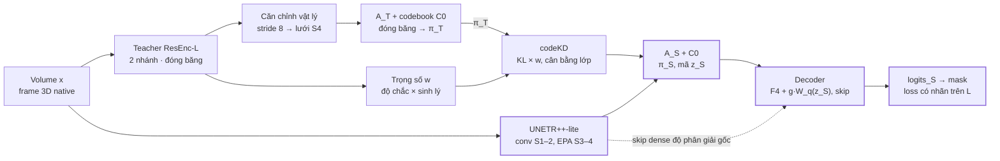

# Q-3D: Student-only quantized distillation — technical spec

Nov 11, 2026 · Alvin · bản gốc có thể sửa: [Claude Doc](https://claude.ai/artifact/A3tMfHzcbdpHqAQ9pkwZXE). Trạng thái: thiết kế, chưa có kết quả thực nghiệm.

val = development set cũ (DEV18); key nội bộ giữ tên development.

## 1. Phạm vi và quyết định đã chốt

Q-3D là một candidate mới, nằm cạnh A-3D, theo hợp đồng **chỉ student chạy khi deploy**. Teacher nnFoundationCNN ResEnc-L hai nhánh chỉ dùng lúc train. Tri thức truyền qua một codebook chung được neo theo teacher (codeKD) trên ảnh không nhãn, có trọng số theo độ nhất quán sinh lý. Student là UNETR++ rút gọn, giữ đường dense cho biên.

Nguồn tổng hợp: atlas `teacher_student_paper_architecture_vi.pdf` (10 trang), ghi chú "Thay graph bằng representation lượng tử hóa", và các chỉnh sửa đã chốt trong chat ngày 11/11/2026. Code đối chiếu: `QuocKhanhLuong/Self-Audit` `main@c7582bb`.

| Quyết định | Chốt | Thay đổi so với nguồn |
| --- | --- | --- |
| Deploy | Chỉ student, không teacher, không cascade | Bỏ khối cascade và cộng logits teacher của atlas (trang 1, 6) |
| Teacher | nnFoundationCNN ResEnc-L: encoder pretrained, decoder/heads mới | [AMEND] 2026-11-12; thay teacher cũ riêng trong Q3D |
| Interface | Codebook chung neo theo teacher, đóng băng sau khi học tokenizer | Ghi chú học codebook chung với cả hai adapter → đổi thành neo teacher |
| Residual tầng 2 ("private") | Tắt trong main, bật ở phase sau, khởi tạo đóng góp bằng 0 | Đổi tên thành residual tầng 2; không claim "private" |
| Đường dense student | Không lượng tử hóa; skip độ phân giải gốc đi thẳng tới decoder | Ghi chú cho decoder chỉ đọc mã → đổi thành ablation |
| Trọng số codeKD w\_p | Độ chắc của teacher × độ nhất quán sinh lý của bệnh nhân | Ghi chú để trống w\_p |
| Student | UNETR++-lite: conv ở stage 1–2, EPA ở stage 3–4, decoder conv nhẹ | Atlas dùng EPA mọi stage; support thích nghi A\_c/A\_d → ablation |
| Teacher trong joint | Đóng băng (main); online là ablation | Atlas cập nhật teacher xen kẽ |
| Semi cho teacher | Không trong main | Giữ atlas trang 8 |

**Non-goals (không làm trong Q-3D):** policy chọn query K1, packet/bit codec, đồ thị trạng thái tim, cascade T+S, teacher thời gian, test-time adaptation, đếm bit. A-3D giữ nguyên làm baseline; không sửa file nào trong `self_audit/candidate_a3d/` ngoài import.

**[AMEND — LỊCH SỬ trước migration ResEnc] Trạng thái bản sửa 2026-11-12:** P0–P5 theo hợp đồng sửa này đều `NOT_RUN`; kiểm tra hàm thuần CPU/synthetic chỉ là `SOFTWARE_ONLY`. Main đã có triển khai Q3D tại `28e1a36be014a0d75272d5aca3fff18e482d3593`; kiểm tra lịch sử không chứng minh triển khai đó đáp ứng bản sửa. Chưa có kết quả bệnh nhân, GPU hay novelty. Đợt khóa helper tại `b31eb9f` chỉ sửa spec và hàm thuần. **[AMEND] Đợt tích hợp tiếp theo nối hợp đồng weighting vào engine codeKD/feature KD; kiểm chứng CPU/synthetic là SOFTWARE_ONLY, chưa hoàn thành toàn bộ P0–P5.**

## 2. Kiến trúc tổng thể và hợp đồng tensor

Mỗi bước train chạy teacher (đóng băng) và student trên cùng một volume; teacher chỉ sinh target cho student trên lưới stage 4. Lúc deploy chỉ còn đường student: encoder, interface mã với codebook đã đóng băng, decoder.



Chỉ bốn khối E, AS, D, O chạy khi deploy.

Teacher và tokenizer đóng băng chỉ tạo π\_T và trọng số w khi train; lúc deploy chỉ còn bốn khối tô màu.

Ký hiệu: B batch, D số lát native, H×W in-plane native, h = ceil(H/16), w = ceil(W/16). Mọi tensor ảnh ở native grid, không resample, không crop, như hợp đồng hiện tại của `CandidateA3DData`.

| Tensor | Shape | Nguồn | Ghi chú |
| --- | --- | --- | --- |
| `x` | \[B,1,D,H,W\], float trong \[0,1\] | `CandidateA3DData` | Hợp đồng hiện có; có `geometry` (spacing\_zyx mm, affine) |
| `region_logits`, `boundary_logits` | \[B,4,D,H,W\] | `Q3DResEncTeacher` | Decoder/head mới |
| `sdf_T` | \[B,4,D,H,W\] | `Q3DResEncTeacher` | Giữ 4 kênh BG/RV/MYO/LV |
| `F_T_src` | [B,256,Dp/sz,Hp/8,Wp/8] | [AMEND] ResEnc encoder stage 3 | sz là tích stride z đến stage 3; không mặc định z=8 |
| `F_T_aln` | \[B,C\_T,D,h,w\] | Mục 4 | Teacher đã căn về lưới stage 4 của student |
| `u_T`, `u_S` | \[B,64,D,h,w\], chuẩn hóa L2 theo kênh | Adapter A\_T, A\_S |  |
| `C0` | \[256,64\], chuẩn hóa L2 | Tokenizer, mục 5 | Đóng băng sau tokenizer stage |
| `pi_T`, `pi_S` | \[B,256,D,h,w\] | Softmax cosine/τ | Phân bố gán mềm trên C0 |
| `cls_T4` | \[B,D,h,w\], int | [FIX] (§4) argmax phân suất region teacher trên ô S4 có tâm đúng pha | Dùng để cân bằng lớp trong codeKD |
| `logits_S` | \[B,4,D,H,W\] | Student | Đầu ra deploy duy nhất |
| `sdf_S` | \[B,4,D,H,W\] | Student, head phụ | Chỉ khi train; bỏ khi export |

**[AMEND] Geometry teacher:** input student giữ chuẩn [0,1]; teacher z-score riêng trên toàn volume trước padding. Teacher pad replicate phía cao của từng trục tới bội số tích stride của trục đó, không đặt kích thước tối thiểu gấp đôi. Không crop/resample ảnh; chỉ cắt phần padding khỏi logits/SDF đầu ra. Các phép đo Phase 0 được lưu tại `reports/q3d-resenc-phase0-20261112/`.

## 3. Teacher: nnFoundationCNN ResEnc-L

**[AMEND] 2026-11-12 — thay thiết kế teacher trước đây:** chỉ Q3D đổi teacher; baseline A/A-3D không thay đổi. Phương án SCRATCH được hủy trước khi publish. Không còn fallback teacher cũ hoặc TinyEncoder trong Q3D.

`build_resenc_l(strides)` sao tham số `get_res_enc_l` của [nnssl tại pin](https://github.com/MIC-DKFZ/nnssl/blob/3d774e942256bd70e5e264c6b94fa38e25f7ed74/src/nnssl/architectures/architecture_registry.py), dùng `dynamic_network_architectures==0.4.4`: 6 stage, kênh [32,64,128,256,320,320], số residual block [1,3,4,6,6,6], kernel 3, InstanceNorm3d affine eps=1e-5 và LeakyReLU. Strides là cấu hình khóa từ Phase 0; thay stride không thay shape tensor weights.

**[AMEND] Khóa sau sửa spacing:** dùng strides `[(1,1,1),(1,2,2),(1,2,2),(2,2,2),(1,2,2),(1,2,2)]` suy từ median train đã sửa theo §4. Giữ nguyên kernel/weights, native voxel và padding multiple (2,32,32); chỉ chuyển vị trí downsample z theo luật planner đã pin.

**Pretrained encoder:** HF `MIC-DKFZ/nnFoundationCNN`, revision `f443c09319988e833b3d9589bf95909e4443d7b2`, `checkpoint_final.pth`, SHA-256 `ac262d3e8c226c79f9567fddc34d38e011284730ddf2294b5c6c319ce2f22bbd`. Nạp bằng `torch.load(weights_only=True)`, kiểm `arch_class_name=ResEncL`, `key_to_stem=encoder.stem`, `key_to_encoder=encoder.stages`, rồi strict load toàn encoder. Không bỏ các alias `all_modules.*` cần cho strict load. Bỏ mọi checkpoint key `decoder.*`, kể cả alias `decoder.encoder.*`; decoder, segmentation head và boundary khởi tạo mới. Hai lần build cùng seed phải giống state.

`Q3DResEncTeacher` có encoder → skips → `UNetDecoder` 4 lớp. Nhánh boundary import `_BoundaryPath3D` từ baseline nhưng không sửa nó, đọc skip stage 0 và stage cuối. Output là `region_logits`, `boundary_logits`, `sdf`, cùng feature source theo hợp đồng. Hai nhánh chung trunk nên đồng thuận không phải bằng chứng độc lập.

**Provenance real:** chỉ `architecture=nnfoundation_resenc_l` và `READY`, đầy đủ file/SHA, HF resolve URL chứa revision commit, dataset pretrain, overlap note và license. Dataset khai báo: nnFoundation (~2.1M CT/MR/PET, 125 sources; arXiv 2609.26924 Table D7). `overlap_acdc=false`, `overlap_mnms=false` **theo Table D7, chưa kiểm độc lập**. License weights `CC-BY-SA-4.0`. Đây là giới hạn provenance được công khai, không phải kết luận đã audit toàn bộ bệnh nhân pretrain.

**Loss:** CE + Dice foreground cho region và boundary; SDF near/far riêng Q3D như trước: signed distance mm/R với R=5 mm, clip [-1,1], gần biên |d|<2.5 mm, alpha=0.5, lớp vắng +1. Chỉ đọc GT trong L; tái dùng target/loss primitives của baseline, không sửa baseline.

**Lịch T (8.000 update, AdamW, wd=1e-4):**

| Phase | Update | Trainable | LR |
| --- | --- | --- | --- |
| T-a | 5% đầu | Decoder + region head + boundary; encoder đóng băng | 1e-3 |
| T-b | Phần còn lại | Toàn mạng | Encoder 1e-4; decoder/heads 1e-3; warmup LR 5% rồi cosine |

Các group không trùng parameter identity; phải loại alias encoder trong decoder. `teacher_boundary_lr` được giữ làm alias tương thích và bắt buộc bằng `teacher_head_lr`, vì boundary thuộc chung group heads; không có LR boundary bị bỏ qua âm thầm. Chọn checkpoint theo VAL FG Dice patient-macro hiện có. Mỗi 400 update log loss train và VAL FG/RV/MYO/LV của nhánh region. Manifest T lưu `teacher_dev_fg_dice`, per-class tại checkpoint được chọn, và `dev_curve_still_improving` từ ba lần VAL cuối (tăng nghiêm ngặt, thiếu ba điểm thì chưa xác định). Chỉ báo cáo, không tự tăng budget. Joint đóng băng teacher/adapter/codebook; O1 giữ là code ablation ngoài campaign.

**Feature source:** main `encoder_stride8` = stage 3, 256 kênh; tên stride là theo in-plane, stride z lấy từ config. S1 `encoder_stride16` = stage 4, 320 kênh. Không còn nguồn decoder, stride4 hay bottleneck teacher cũ. Synthetic dùng chính `Q3DResEncTeacher` với kênh/block nhỏ, cùng forward/load/phase contracts; không chứng minh hiệu quả bệnh nhân.

## 4. Căn chỉnh pha và phép đo ERF

**[AMEND] Geometry ACDC theo pixdim (người dùng chấp thuận ngày 2026-11-12):** audit header gốc ghi nhận sform có scale đơn vị mâu thuẫn với pixdim và một số CINE không có form được code. Policy riêng `acdc_pixdim_native_v1` được phép lấy độ dài voxel từ pixdim hữu hạn, dương, khác (1,1,1), với đơn vị mm được khai báo có provenance khi header không ghi đơn vị; nguồn đơn vị là [mô tả acquisition ACDC chính thức](https://www.creatis.insa-lyon.fr/Challenge/acdc/databases.html). Dựng lại affine bằng các hướng trục trực giao đã chuẩn hóa của affine nibabel chọn, nhân độ dài pixdim theo từng trục và giữ translation sau đổi đơn vị. Khi không có form được code, chỉ policy này được dùng base affine của nibabel và phải ghi rõ. Đây là quy ước tọa độ ảnh native được dựng lại, **không xác nhận scanner-world pose**. Ghi nguyên sform/qform/affine gốc, affine dựng lại, policy, provenance đơn vị và mọi xung đột đã được amendment cho phép. Vẫn dừng khi thiếu header, pixdim không hợp lệ, trục suy biến/shear hoặc hướng của các form được code mâu thuẫn. Default strict không đổi; không sửa NIfTI, voxel, nhãn, patient ID, selector hay split. Manifest mới chỉ đổi geometry, phải có receipt và SHA mới. Khóa stride/pha lịch sử bên dưới được thay thế bằng phép đo lại cùng seed/ngưỡng được ghi ở mục khóa geometry sau pixdim.

**[AMEND]** Giữ native grid của cả hai mạng. Lưới nhánh chính ResEnc được suy theo từng trục từ chuỗi kernel/stride/padding thật: `j_new=j*a`, `o_new=o+((k-1)*d/2-p)*j`. High-side input padding không đổi gốc tọa độ. Student stage 4 giữ stride (1,16,16). Không dùng phép avg-pool teacher stride8 để giả làm lưới student: tâm sẽ lệch.

Residual skip dùng avgpool khi downsample nên không tự giả định cùng lattice với nhánh conv chính. Phase 0 phải ghi bước/offset nhánh chính đến stage 3, độ lệch cực đại của skip lattice, và đo gradient ERF trên encoder pretrained: một cell stage 3, input ngẫu nhiên z-score, trung bình ít nhất 16 mẫu. Báo input shape, cell/channel aggregation, seed và tâm khối gradient. Luật khóa trước: lệch không quá 2 voxel trên mọi trục dùng pha nhánh chính; vượt ngưỡng dùng offset đo được, lưu manifest. Không chọn pha theo VAL/test.

Strides z suy từ median spacing train bằng luật planner ResEnc mặc định được pin, giữ nguyên native shape. Báo rõ các điều kiện min-feature-map/shape của planner; không âm thầm resample hay đổi kernel để làm vừa. Quyết định strides/phase khóa trước training và nằm trong config/artifact identity. Nội suy feature dùng bước và offset thực, crop về lưới student, output detach.

**[AMEND — LỊCH SỬ trước sửa spacing] Phase 0:** median train metadata ZYX spacing (1,1,1) mm, native shape (9,256,216); 52/80 records có unit spacing và raw headers chưa đối chiếu độc lập. Strides cũ `[(1,1,1),(2,2,2),(1,2,2),(1,2,2),(1,2,2),(1,2,2)]`, receipt SHA `2f05888b45ff3bfbf19f90bd91abbd4f0b2ab193b37375c5d875950117d2a14e`, mean offset=(0.6721337438,1.9470438957,1.7222030163) voxel được giữ làm lịch sử; không dùng để khóa geometry mới. Các probe khác center/padding vẫn giữ NONCALIBRATION.

**[AMEND] Khóa geometry sau pixdim:** median train ZYX spacing=(10,1.5625,1.5625) mm, median shape=(9,256,216), median z=10 mm, dị hướng=6.4. Pinned topology/min feature-map 4 cho strides mới tại §3, full padding multiple=(2,32,32). Main stage3 step=(2,8,8), offset=(0,0,0); pure skip displacement cực đại=(0.5,3.5,3.5). Canonical CPU probe vẫn dùng 16 seed42–57, logical (33,97,97), replicate-pad (34,128,128), cell (8,6,6), signed mean 256 channels: signed mean offset=(0.6737596988677979,1.7588436603546143,1.2107672691345215) voxel, mọi trục ≤2, nên khóa **main phase, correction zero**. Max individual offset=3.921062469482422 chỉ là diagnostic. Receipt `reports/q3d-resenc-pixdim-20261112/erf_probe.json`, SHA `36f44d7f85cd3872168b01339353fb17787099d309e167ea5d64ffbc1721b72b`, là bằng chứng **SOFTWARE_ONLY** trên input ngẫu nhiên, không phải chất lượng bệnh nhân. S1 ngoài campaign giữ analytical stage4 phase, chưa đo ERF riêng. GPU profile/training **NOT_RUN** tại thời điểm khóa này.

Tests: source isotropic khớp tham số và state keys/shapes upstream; pha nhánh chính từ conv thật; constant/ramp align và H/W lẻ; anisotropic stride/padding/crop đúng; gradients teacher bị chặn ở joint. ERF random-input là chẩn đoán hình học của weights, không phải chứng minh receptive field trên MRI bệnh nhân hay gate chất lượng segmentation.

## 5. Tokenizer teacher và codebook chung

Codebook do teacher định nghĩa rồi đóng băng; student chỉ học dự đoán mã của teacher. Điều này chặn lời giải tầm thường khi hai adapter tự do cùng dồn mọi vị trí vào vài mã (cách BEiT v2 neo tokenizer theo teacher).

**Thành phần (`self_audit/candidate_q3d/tokenizer.py`):**

| Thành phần | Cấu hình | Sau stage tokenizer |
| --- | --- | --- |
| Adapter A\_T | Conv 1×1×1 (C\_T→128) → GELU → Conv 1×1×1 (128→64) → chuẩn hóa L2 | Đóng băng |
| Codebook C0 | K = 256 mã, d = 64, mỗi mã chuẩn hóa L2 | Đóng băng, lưu kèm version + SHA-256 |
| Decoder tái tạo R\_T | Conv 1×1×1 (64→C\_T) | Bỏ |
| Head giải phẫu H\_A | Linear 64→4 | Bỏ |

**Gán mã:** độ giống cosine giữa u và từng mã. Mã cứng = mã có cosine lớn nhất. Phân bố mềm = softmax của cosine chia τ, τ = 0,1 cố định. Chuẩn hóa L2 chặn adapter đổi độ lớn vector để làm phân bố cứng hay mềm tùy ý, và giảm mã chết (như ViT-VQGAN).

**Học codebook:**

- Khởi tạo bằng k-means++ trên u\_T của 200 volume đầu (L và U).
- Cập nhật bằng EMA của các vector được gán, decay 0,99, rồi chuẩn hóa lại L2. Đây là EMA của centroid, không phải EMA teacher tạo pseudo-label.
- Mã có tần suất dùng dưới 0,1% trung bình trong 200 update gần nhất được thay bằng một u\_T ngẫu nhiên (dead-code restart).

**Loss tokenizer (chỉ cập nhật A\_T, R\_T, H\_A; teacher đóng băng; không dùng GT):**

- Commitment: β = 0,25 nhân khoảng cách bình phương giữa u\_T và mã được gán (đã detach).
- Tái tạo: L1 giữa R\_T(mã) và F\_T\_aln đã detach, chia độ lệch chuẩn theo kênh của F\_T\_aln. Straight-through: forward dùng mã, gradient đi về u\_T.
- Giải phẫu: cross-entropy mềm giữa H\_A(mã) và phân suất lớp của ô, **[FIX] (§4)** lấy từ xác suất region teacher trên ô S4 có tâm đúng pha. Mục đích: mã mang giải phẫu, không chỉ texture. Trọng số 0,5.

**Stage Q:** 1.000 update trên L và U (ảnh U là image-only, đúng hợp đồng hiện tại), sau stage T.

**[OPEN] Rà soát support MYO trước P2 sau sửa geometry:** GT L8 tại đúng pha S4 cho 245/29.664 ô thắng MYO (0,825916936%), dưới trigger 2%. Review độc lập ghi trong báo cáo geometry: 245 ô không làm yêu cầu ≥4 mã bất khả thi về cardinality, nhưng không đảm bảo teacher/codebook đạt coverage. Gate Q đo soft teacher class mass/majority, không đo GT support này; anatomy CE của Q đang trung bình đều theo ô và vẫn có rủi ro lớp hiếm. Giữ nguyên design, cân bằng codeKD và mọi ngưỡng; không tự thêm trọng số cho Q. Sau review chạy Q với gate thật đã khóa; thiếu ≥4 mã MYO hoặc bất kỳ gate nào fail thì dừng, không nới. Đây là OPEN đã rà soát, chưa có bằng chứng tokenizer đạt gate.

**Metrics ghi mỗi 50 update:** perplexity của phân bố sử dụng mã, số mã chết, số mã chiếm đa số trong mỗi lớp teacher, churn (tỉ lệ ô đổi mã cứng giữa hai snapshot).

**Gate trước khi sang stage joint** (giá trị khởi điểm, khóa trước khi chạy): perplexity ≥ 32; mã chết ≤ 25%; mỗi lớp RV, MYO, LV có ≥ 4 mã mà phần lớn khối lượng rơi vào lớp đó. Không đạt thì dừng và báo cáo, không nới gate.

**[AMEND] Báo cáo P0 về support lớp:** chỉ trên GT của L, đo tỉ lệ ô mà mỗi lớp thắng argmax phân suất lớp tại lưới S4 đúng pha (§4); báo số ô, tần suất BG/RV/MYO/LV, tie chọn chỉ số lớp nhỏ nhất. **[OPEN] Nếu MYO < 2% tổng số ô**, gate “≥ 4 mã MYO” và cân bằng lớp MYO phải được xem lại trước P2. Dừng để xem xét thiết kế, không tự đổi ngưỡng hoặc dùng U/val/test GT.

## 6. Student UNETR++-lite

Student là UNETR++ rút gọn cho volume tim native: conv ở hai stage đầu, EPA ở hai stage cuối, không bao giờ hạ trục z, decoder conv nhẹ với skip cộng. Ngân sách: ≤ 10M tham số; đo latency GPU (bf16, batch 1) và CPU trong P1.

**Encoder** (input pad in-plane tới bội số của 16 bằng replicate ở phía cuối, crop output về; D không pad):

| Stage | Stride tích lũy (z,y,x) | Kênh | Khối | Depth |
| --- | --- | --- | --- | --- |
| F0 | (1,1,1) | 16 | Conv k(1,3,3) → conv residual k3, InstanceNorm, GELU | 1 |
| S1 | (1,2,2) | 32 | Down conv k(1,3,3) stride (1,2,2) + conv residual k3 | 1 |
| S2 | (1,4,4) | 64 | Như S1 | 1 |
| S3 | (1,8,8) | 128 | Down + khối EPA | 2 |
| S4 | (1,16,16) | 256 | Down + khối EPA | 2 |

**Khối EPA cho shape biến đổi.** EPA gốc chiếu K, V từ N token xuống P bằng ma trận tuyến tính phụ thuộc N, nên chỉ chạy với input cố định kích thước. Volume native có D, H, W khác nhau theo bệnh nhân, nên phải thay:

- Nhánh spatial: Q là toàn bộ N token; K và V được pool trung bình có mask về lưới cố định (min(D,4), 4, 4), tức P ≤ 64. Token pad không được tính vào pooling. Đây là "uniform support" của atlas trang 9.
- Nhánh channel: attention C×C tính trên token hợp lệ, Q và K chuẩn hóa L2 như bản gốc.
- 4 head; nối hai nhánh rồi chiếu về C; residual; sau đó FFN là conv depthwise k3 + conv 1×1.
- Support thích nghi A\_c/A\_d của atlas trang 4 là ablation E1, không phải main.

**Interface mã tại S4:**

- Adapter A\_S: conv 1×1×1 256→128 → GELU → 128→64 → chuẩn hóa L2, ra u\_S.
- pi\_S = softmax(cosine(u\_S, C0)/τ) với C0 và τ của teacher (đóng băng).
- Mã cứng z\_S qua straight-through. Đưa vào decoder: F4 + g · W\_q(z\_S), W\_q là conv 1×1×1 64→256, g là scalar học được, khởi tạo 0. Decoder bắt đầu từ đường liên tục, rồi tự học dùng mã.
- Ablation "chỉ mã" (B1): decoder chỉ nhận W\_q(z\_S), bỏ F4 và mọi skip. Đây là dạng nút cổ chai kiểu A-3D.

**Decoder:** mỗi bước upsample (1,2,2) trilinear + conv 1×1×1 giảm kênh, cộng skip cùng stage, một khối conv residual k3. Chuỗi kênh 256→128→64→32→16. Head: conv 1×1×1 16→4 ra `logits_S`; head SDF 16→4 với tanh ra `sdf_S`, chỉ khi train. Không dùng deep supervision trong main.

**Tối ưu triển khai:** bf16 autocast khi train và infer; layout `channels_last_3d` cho conv; `F.scaled_dot_product_attention` cho nhánh spatial; `torch.compile` tùy chọn; infer cả volume một lần, không sliding window.

**Nếu vượt 10M tham số:** giảm kênh S4 xuống 192 trước, rồi S3 xuống 96. Không cắt F0 và skip độ phân giải gốc.

## 7. Toàn bộ loss và đường gradient

Student học từ bốn loss: hai loss có nhãn trên L, codeKD trên U (và L), commitment. Teacher và codebook không nhận gradient nào trong stage joint.

| ID | Stage | Dữ liệu | Loss | Trọng số khởi điểm | Cập nhật |
| --- | --- | --- | --- | --- | --- |
| T1 | T | L | CE + Dice foreground, `region_logits` | 1 | Teacher |
| T2 | T | L | CE + Dice foreground, `boundary_logits` | 1 | Teacher |
| T3 | T | L | SDF cân bằng gần/xa (mục 3) | 1 | Teacher |
| Q1 | Q | L + U | Commitment u\_T với mã được gán | β = 0,25 | A\_T |
| Q2 | Q | L + U | Tái tạo F\_T\_aln, L1 chuẩn hóa theo std kênh | 1 | A\_T, R\_T |
| Q3 | Q | L + U | Cross-entropy mềm với phân suất lớp teacher theo ô | 0,5 | A\_T, H\_A |
| S1 | Joint | L | CE + Dice foreground, `logits_S` | 1 | Student |
| S2 | Joint | L | SDF cân bằng gần/xa, `sdf_S` | λ\_d = 1 | Student |
| S3 | Joint | U (chính) + L | codeKD cân bằng lớp, nhân w (mục 8) | λ\_k = 1, ramp tuyến tính 0→1 trong 10% update đầu | Encoder student, A\_S |
| S4 | Joint | L + U | Commitment u\_S với mã cứng của chính nó | β = 0,25 | Encoder student, A\_S |

Tổng stage joint: S1 + λ\_d · S2 + r(t) · λ\_k · S3 + S4.

**[FIX] codeKD (S3), theo từng frame f của bệnh nhân p.** Đặt `ell_i = KL(sg(pi_T(i)) || pi_S(i))`; chỉ w_cell tham gia trung bình trong lớp:

```latex
s_{f,c}=\sum_{i:\mathrm{cls}_{T,f}(i)=c}w_{\mathrm{cell},f,i},\qquad
\mathcal C_f=\{c:s_{f,c}>0\},
B_f=\frac{1}{|\mathcal C_f|}\sum_{c\in\mathcal C_f}
\frac{\sum_{i:\mathrm{cls}_{T,f}(i)=c}w_{\mathrm{cell},f,i}\,\ell_i}{s_{f,c}},
\qquad L_f=\omega_p B_f.
```

**[FIX]** Không có epsilon hay w_pat trong mẫu số. Trung bình đều các lớp có tổng w_cell > 0, kể cả BG. Lớp có tổng bằng 0 bị loại khỏi C_f và ghi log, không pha loãng mẫu số. Nếu C_f rỗng, trả loss 0 hữu hạn vẫn giữ autograd graph, gradient student bằng 0 như nhánh rỗng của `consistency_loss`.

**[FIX] Lý do:** công thức cũ đặt w_cell·w_pat ở cả tử và mẫu nên triệt tiêu trọng số bệnh nhân. Probe CPU/synthetic cho loss/grad xấp xỉ 1,000× (làm tròn ba chữ số) khi w_pat ∈ {1, 0.1, 1e-4}; epsilon chỉ phá tính bất biến gần 0. Nó thực chất tạo cổng cứng ẩn ở r_SV ≈ 6–7τ, phụ thuộc tổng support/epsilon. Đây là `SOFTWARE_ONLY`, không phải bằng chứng bệnh nhân.

**[AMEND] Ramp:** `r(t) = min(1, t/800)`, t là số optimizer update đã hoàn thành trước update hiện tại (0-based), tăng từ 0 tới 1 trong 10% của 8.000 update J. Resume lưu t. Không dùng `candidate_a3d.semisupervised.ramp_weight` vì hàm đó nhận epoch. Một cặp L/U tích lũy hai luồng rồi một optimizer step: 8.000 cặp L/U = 8.000 optimizer step.

**[AMEND] Hợp đồng hàm thuần trước P0–P5:**

- `weighted_class_balanced_reduce(per_cell_loss, cls, w_cell, omega) -> (loss, stats)` nhận loss `[D,h,w]` hoặc `[B,D,h,w]`; cls/w_cell cùng `[D,h,w]`. Khi có B, áp map chung cho từng frame rồi mean các loss frame; cohort thật với map khác nhau gọi riêng từng frame. Validate shape, finite, lớp nguyên BG/RV/MYO/LV, w_cell ≥ 0 và omega ≥ 0; weights detach. Stats ghi lớp active/excluded, tổng trọng số lớp, base loss và omega.
- `cohort_omega(w_pat, arm) -> dict` trả `omega` (patient → float), `mean_w_pat`, `ess`, `ess_fraction`, `mean_omega`, `max_omega`, `zero_fraction`. Đầu vào U không rỗng, weights finite/nonnegative. V1/C1 và V1-u dùng cùng cohort U đủ gate §8; V1-u chỉ bỏ trọng số tương đối. `arm="L"` trả omega = 1 và không áp gate U. Không trộn L/U trong một đầu vào.
- `tests/test_candidate_q3d_weighting.py` khóa tỉ lệ loss/grad 1:0,1:0; anti-regression công thức cũ; ví dụ tay; zero-support không pha loãng; all-zero giữ graph; mean omega/ESS/gate; L/V1-u; weights bằng nhau cho V1/V1-u trùng từng bit. **[AMEND] API thực thi B1:** `codekd_loss(pi_T, pi_S)` và `feature_kd_loss(F_T, F_S)` chỉ trả map per-cell `[B,D,h,w]` (KL hoặc 1−cos). Engine gọi `weighted_class_balanced_reduce` riêng mỗi frame với `cls`, `w_cell`, `omega`, rồi mean loss frame; không giữ reducer riêng có epsilon. Engine truyền omega = 1 trên L và omega cohort trên U, kể cả nhánh zero-support giữ graph. Bản khóa helper `b31eb9f` chưa nối engine; kiểm chứng tích hợp là `SOFTWARE_ONLY`, không thay thế acceptance toàn bộ P4.

**Đường gradient:**

- Teacher chạy `no_grad`, eval mode; `pi_T`, `cls_T4`, w đều detach.
- C0 là buffer, không phải parameter; student không cập nhật codebook.
- Straight-through tại S4: forward dùng mã cứng, gradient của S1 và S2 đi qua W\_q về u\_S.
- Test tự động: sau một bước joint, mọi tham số teacher, A\_T và C0 không đổi từng bit.

## 8. Trọng số w: độ chắc của teacher × độ nhất quán sinh lý

**[FIX]** w_cell chỉ dùng trong reducer theo lớp (§7); omega nhân bên ngoài. w_pat đo tính nhất quán sinh lý của mask teacher, không học từ K bệnh nhân có nhãn và không dùng metadata ED/ES. **Frame L: omega = 1 ở mọi arm. U V1/C1: omega_p = w_pat(p)/mean_U(w_pat). U V1-u: omega ≡ 1.** Mean tính một lần trên toàn bộ bệnh nhân U trong cache đóng băng, không theo minibatch/frame, không chuẩn hóa lại ở từng lớp.

**w\_cell:** trung bình trên các voxel của ô của xác suất lớn nhất trong `region_logits` teacher. Nếu nhỏ hơn 0,7 thì w\_cell = 0, ngược lại bằng chính giá trị đó (0,7 là ngưỡng đang dùng trong semi profile).

**w\_pat, tính một lần cho mỗi snapshot teacher (`self_audit/candidate_q3d/physiology.py`):**

1. Chạy teacher (`no_grad`) trên mọi frame cine của bệnh nhân U. Thể tích mỗi lớp LV, RV, MYO theo mL = tổng xác suất softmax × thể tích voxel (tích spacing\_zyx / 1000).
2. ED = frame có thể tích LV lớn nhất; ES = frame nhỏ nhất. Không đọc metadata, đúng hợp đồng `unlabeled_frame_keys`.
3. Thể tích tống máu mỗi thất = thể tích ED trừ ES. Phần dư r\_SV = chênh lệch tuyệt đối giữa thể tích tống máu LV và RV, chia trung bình của hai giá trị.
4. Phần dư r\_M = chênh lệch tuyệt đối thể tích MYO giữa ED và ES, chia trung bình của hai giá trị.
5. w\_pat = exp(−½ (r\_SV/τ\_SV)²) × exp(−½ (r\_M/τ\_M)²). Khởi điểm τ\_SV = 0,15 và τ\_M = 0,10; P0 kiểm trên GT của L (trong ngân sách K) rồi khóa.

**Chặn ca teacher hỏng (w\_pat = 0):** thể tích tống máu LV ≤ 0; thể tích LV ED < 10 mL; EF LV ngoài \[5%, 90%\]. Các ngưỡng này là kiểm tra hợp lý thô, không phải tiêu chuẩn lâm sàng.

**Cổng theo dataset:** cờ `physio.stroke_balance` trong config. Tắt cho dataset có hở van ba lá hoặc thông liên nhĩ theo thiết kế (M&Ms-2), khi đó chỉ còn thành phần khối cơ tim. Dataset chỉ có ED/ES (không có cine) vẫn tính được nếu biết hai frame; dataset không có nhãn RV thì tắt thành phần tống máu.

**[FIX] Cache:** mỗi bệnh nhân một dòng JSON gồm id, SHA checkpoint teacher, đường thể tích theo frame, chỉ số ED/ES, r\_SV, r\_M, w\_pat; metadata cache ghi cohort U, N_U, mean_U(w_pat), ESS, ESS/N_U; file cache có SHA-256. Teacher đóng băng nên chỉ tính một lần trước joint; O1 tính lại mỗi 10 epoch và mỗi snapshot mới phải tính lại mean/gate.

**[FIX] Gate trước joint, khóa trước khi dùng kết quả:** chỉ dùng w_pat trên U: `mean_U(w_pat) > 0` và `ESS/N_U = (Σw)²/(N_U·Σw²) ≥ 0,25`. Không đạt thì dừng, không nới. **Log mỗi run:** mean(omega) (phải bằng 1 trên mỗi vòng U đầy đủ, mỗi bệnh nhân góp một lần), max omega, tỉ lệ omega = 0, ESS và ESS/N_U. L không tham gia mẫu số U. Gate không dùng kết quả arm hoặc val/test. V1-u dùng cùng cohort đủ gate để so sánh trọng số tương đối công bằng.

**[FIX] Log vòng U thực tế:** `realized_mean_omega` là trung bình các omega engine đã dùng trong đúng một hoán vị U (§9), không sao chép mean của cache. Lưu các quan sát giữa vòng trong checkpoint; khi vòng đủ, V1/C1 có gate hợp lệ phải đạt 1 với sai số tuyệt đối ≤ 1e-12. Ghi thêm max/zero fraction thực tế và các SHA snapshot đã dùng. O1 vẫn refresh theo lịch đã khóa; nếu đổi snapshot giữa vòng thì giữ toàn bộ quan sát, ghi các SHA và mean thực tế, không ép mean của vòng trộn snapshot thành 1. Synthetic override gate phải được ghi rõ và không được diễn giải là đạt hợp đồng dữ liệu thật.

**Chẩn đoán (chỉ báo cáo):** tính w\_pat trên bệnh nhân val và báo tương quan Spearman với Dice RV và HD95 thật của teacher. Không dùng số này để chọn τ.

## 9. Dữ liệu, protocol nhãn và lịch train

Protocol chính là A: K bệnh nhân có nhãn cho cả hệ, phần train còn lại U image-only. **[AMEND] Campaign hiện tại: ACDC seed42, so sánh đóng góp ở K8; V1@5 và V1@10 chỉ là đường cong số nhãn.** K2 vẫn hợp lệ trong config nhưng không thuộc campaign.

**Protocol:**

|  | A (chính) | B (tham chiếu) |
| --- | --- | --- |
| Teacher dùng GT | K bệnh nhân | Toàn bộ train |
| Student dùng GT | Cùng K | K bệnh nhân |
| U | train còn lại, image-only | train còn lại, image-only với student |
| Claim | Hiệu quả ít nhãn của cả hệ | Trần khi teacher mạnh |

Không chia sẻ checkpoint, cache sinh lý hay codebook giữa A và B. Provenance nnFoundation ngoài phải khai báo ở cả hai; overlap theo Table D7 chưa được kiểm độc lập.

**Dataset:** ACDC và M&Ms gốc trước, mỗi bộ train và test riêng; sau đó hai bộ CMR còn lại (chưa xác định tên). Test chéo: train ACDC, test M&Ms và hai bộ kia. Dùng manifest và split đã khóa hiện có. Lưu ý: log campaign trước ghi M&Ms còn bị chặn bởi 34 affine không tương thích geometry.

**Sampler stage joint:** mỗi update gồm một frame L (ED hoặc ES có nhãn) và một frame U (frame bất kỳ của một bệnh nhân U, lấy đều theo bệnh nhân). Batch 1 mỗi luồng vì shape native khác nhau; tích lũy gradient 2.

**[FIX] Hoán vị U và resume:** mỗi vòng shuffle lại danh sách bệnh nhân U bằng RNG riêng `seed + 1`, mỗi bệnh nhân góp đúng một lần; frame trong bệnh nhân chọn ngẫu nhiên bằng RNG riêng `seed + 2`. V1 và V1-u có cùng chuỗi bệnh nhân/frame khi seed và cohort giống nhau. Stream L giữ nguyên RNG `seed` và hai lần chọn patient/frame của hợp đồng trước để C0 không đổi. Schema sampler `joint_sampler.v3` và checkpoint `resume.v3` lưu hoán vị, cursor, số vòng đã hoàn thành, các RNG và quan sát omega giữa vòng. Resume v2 phải dừng với lỗi rõ ràng, không tự chuyển đổi stream cũ.

**Augmentation** (trong loader, cùng một phép biến đổi không gian cho ảnh, mask và cả hai đầu vào teacher/student):

- Lật y, lật x, mỗi cái xác suất 0,5. Xoay 90° in-plane chỉ khi spacing y và x bằng nhau (sai số 1e-3), và đổi geometry tương ứng.
- SDF tính lại từ mask đã biến đổi, không biến đổi SDF cũ.
- Cường độ: dùng `strong_intensity` hiện có (gamma \[0,7; 1,5\], nhiễu std 0,03), xác suất 0,5 trên L.
- Trên U cho codeKD: teacher nhận ảnh không augment cường độ, student nhận bản có `strong_intensity`; không gian giống nhau.
- Lật trái–phải đổi phía của RV so với LV, điều không xảy ra trong SAX thật. Giữ vì nnU-Net cũng mirror mặc định, nhưng ghi lại là một lựa chọn có thể đảo.

**Optimizer student:** AdamW, LR 3e-4 (bằng `student_lr` hiện tại), weight decay 1e-4, warmup 5% rồi cosine, gradient clip 1,0, bf16.

**Lịch:**

| Stage | Nội dung | Update | Teacher |
| --- | --- | --- | --- |
| T | Fine-tune teacher trên L (mục 3) | 8.000 | Học |
| Q | Học tokenizer trên L + U (mục 5), rồi kiểm tra gate | 1.000 | Đóng băng |
| P | Tính cache sinh lý trên U (mục 8) | Một lượt forward | Đóng băng |
| J | Student joint (mục 7) | 8.000 | Đóng băng |

Chọn checkpoint student theo VAL FG Dice patient-macro, đánh giá mỗi 400 update. Mỗi stage ghi checkpoint, SHA-256 và có thể resume.

**[AMEND] Log theo epoch quy ước (người dùng chọn ngày 2026-11-12):** T báo VAL Dice patient-macro từng lớp RV/MYO/LV và FG mean sau mỗi `2K` optimizer update (K8: 16); đây là số lượt rút frame ngẫu nhiên, không bảo đảm đã ghé mọi frame. J báo sau mỗi hoán vị bệnh nhân U đầy đủ (K8: 72); C0 không dùng U nên báo mỗi `2K` lượt L. Event `development_epoch` ghi epoch, update và định nghĩa vòng. Đây chỉ là quan sát: chọn checkpoint, lịch LR, loss/ramp, sampler, cache refresh và mọi gate vẫn giữ nguyên, chọn checkpoint mỗi 400 update và update cuối. Khi hai lịch trùng nhau chỉ forward VAL một lần. Đánh giá phụ khôi phục RNG và mode của từng submodule; không thêm nhãn vào train. Không suy ngược hay tạo metric cho các epoch đã qua trước khi bật log.

**[AMEND] Chia sẻ stage B4:** mỗi tổ hợp `(dataset, protocol, K, seed)` chỉ sinh một T và một Q/P chung cho nguồn main. V1 và V1-u dùng cùng teacher, codebook C0 và cache có SHA; C1 dùng cùng T/P và chỉ đọc metadata codebook để xác minh cache. O1 và S1 dùng Q/P riêng nhưng chia sẻ T; hai nguồn feature riêng teacher cũ đã xóa. J nhận manifest stage đã hoàn tất, xác minh SHA, nguồn feature và cohort; không tự train lại T/Q. PLAN chưa chạy chỉ ghi dependency và SHA `NOT_RUN`, không tạo SHA giả.

## 10. Hợp đồng deploy: chỉ student

Artifact export chỉ chứa tham số student, adapter A\_S, W\_q, scalar g và buffer C0 đã đóng băng. Không có tham số, tensor, cache hay codebook version nào khác của teacher.

- **Input:** một frame 3D \[1,1,D,H,W\] trong \[0,1\] và `geometry` (spacing\_zyx, affine), cùng chuẩn hóa với lúc train.
- **Output:** `logits_S` \[1,4,D,H,W\] trên native grid, argmax ra mask BG/RV/MYO/LV.
- **Bỏ khi export:** head SDF, R\_T, H\_A, A\_T, cache sinh lý.
- **Không có lúc test:** teacher, nhãn support, optimizer, test-time adaptation, cine của bệnh nhân.
- **Kiểm tra cold-load:** nạp artifact vào process mới không import module teacher; dự đoán phải trùng từng bit với dự đoán lúc train-time eval trên 3 volume val.
- **Manifest export:** SHA-256 artifact, SHA C0 và version, commit code, tham số, latency GPU/CPU đo được.

## 11. Ablation, baseline, metrics và quy tắc quyết định

Bốn arm chính trả lời ba câu hỏi: VQ có hơn KD liên tục không, teacher có giúp không, trọng số sinh lý có giúp không. Mọi arm dùng cùng student, decoder, dữ liệu, số update và seed.

| Arm | Interface | Teacher signal | w\_pat | Trả lời |
| --- | --- | --- | --- | --- |
| C0 | Liên tục, không có đường mã | Không | — | Mốc student thuần |
| C1 | [FIX] Liên tục; A\_S khớp F\_T\_aln bằng cosine, cùng reducer §7 và omega với V1 | KD feature liên tục | U chuẩn hóa; L = 1 | VQ có cần không (so V1) |
| V1 | VQ, C0 teacher đóng băng | codeKD | [FIX] U chuẩn hóa; L = 1 | **Đề xuất** |
| V1-u | Như V1 | codeKD | [FIX] omega ≡ 1 trên cả L/U | Sinh lý có cần không |

**[AMEND] Phạm vi 6 run:** `v1@8 v1u@8 c1@8 c0@8 v1@5 v1@10`. T/Q/P main dùng chung tại mỗi K=5,8,10: tổng 3 T, 3 Q, 3 P, 6 J. V1/V1u@8 dùng cùng SHA producer T/Q/P; C1@8 cùng T/P. C0 không cần producer. V1@5 và V1@10 chỉ mô tả đường cong theo ngân sách nhãn, không có claim so sánh ablation. Tất cả v0, b1, e1, o1, s1, v1_residual2 và mean_teacher là `NOT_PLANNED`, vẫn giữ code/test. Hai arm nguồn feature riêng teacher cũ bị xóa khỏi Q3D.

**Baseline:** `teacher_supervised@8` đánh giá region head của shared T@8, 0 J, `independent_baseline=false`. A-3D teacher-free@8 chỉ reference khi có bằng chứng cùng manifest/seed/budget và checkpoint; không chứng minh được thì NOT_RUN, không tạo job. Bảng cuối đặt teacher VAL Dice@K cạnh C0@K.

**Manifest khóa:** K8 train `e524c7531079996232fe71cdfe982a46a5950d49d91a8203eee396b0e67434a3`, VAL18 `ba46934afe8ea5c47dd798019bee233c97c98320b358e2d40165e87a651dc7df`. L5 ⊂ L8 ⊂ L10 được kiểm bằng selector hiện có; sai SHA hoặc nesting phải dừng Phase4. Không tạo lại L8 hay đọc U/val/test masks cho training.

**Metrics:**

- Dice từng lớp RV, MYO, LV và FG mean, patient-macro.
- HD95 và ASSD (mm) theo evaluator 3D hiện có.
- Chỉ số lâm sàng trên ED/ES của bệnh nhân test: sai số EDV, ESV, EF của LV và RV; sai số khối cơ tim (thể tích MYO × 1,05 g/mL).
- Harm rate so với C0: tỉ lệ bệnh nhân có FG Dice giảm hơn 0,02.
- Chi phí: tham số, FLOPs, VRAM đỉnh, latency GPU và CPU trên một volume.
- Codebook: perplexity, mã chết, tỉ lệ mã cứng của student trùng teacher trên val.
- Sinh lý: tương quan Spearman giữa w\_pat và Dice RV thật trên val.

**[AMEND] Quy tắc quyết định chỉ tại K8 (khóa trước khi chạy; giữ nguyên ngưỡng):** so sánh paired theo bệnh nhân trên TEST, kèm tỉ lệ bệnh nhân thắng và bootstrap CI 95% theo bệnh nhân.

- VQ đóng góp nếu V1 hơn C1 ≥ 1,0 điểm FG Dice và HD95 không tệ hơn.
- Teacher đóng góp nếu V1 hơn C0 theo cùng tiêu chí.
- Sinh lý đóng góp nếu V1 hơn V1-u, hoặc harm rate giảm rõ.
- Không đạt điều nào thì báo NO-GO cho điều đó, không đổi ngưỡng sau khi xem kết quả.

## 12. Phase triển khai cho coding agent

Code mới nằm trong `self_audit/candidate_q3d/` và `configs/candidate_q3d/`; chỉ import từ `candidate_a3d`, không sửa nó. Mỗi phase kết thúc bằng test xanh, báo cáo và một subagent review độc lập trước khi sang phase sau.

| Phase | Mục tiêu | File chính | Acceptance | Dừng khi |
| --- | --- | --- | --- | --- |
| P0 | [FIX] [AMEND] Read-only, không train | `scripts/q3d_preflight.py` | JSON: HF revision/checkpoint SHA, strict stem/stages và keys/shapes ResEnc; median train spacing/strides; pha main và skip lattice; ERF ≥16 mẫu với luật 2 voxel; VRAM forward hoặc NOT_RUN; near/far thuộc Q3D; r_SV/r_M GT L; tham số student; class support S4 | Thiếu module/C_T sai: dừng; [OPEN] MYO < 2%: xem lại coverage/balancing trước P2, không tự nới |
| P1 | [AMEND] Đăng ký track riêng, student + C0, q3d_teacher_loss | `student.py`, `config.py`, `engine.py` (nhánh C0), `losses.py` | Test shape với H, W lẻ và D ∈ {6, 9, 10, 13, 20}; pad rồi crop trả đúng kích thước; đổi giá trị vùng pad không làm đổi output vùng hợp lệ; ≤ 10M tham số; báo latency GPU/CPU; C0 chạy được trên synthetic fixture và smoke ACDC; đăng ký track như dưới | Vượt 10M sau khi đã giảm kênh theo mục 6 |
| P2 | [FIX] Căn chỉnh theo pha + tokenizer | `alignment.py`, `tokenizer.py`, `teacher_features.py` (main encoder stage3, S1 stage4) | Test §4 gồm phase main/skip/ERF và anisotropic shape; EMA codebook, dead-code restart, đóng băng; metric/gate §5 | Gate tokenizer không đạt trên ACDC |
| P3 | [FIX] Cache sinh lý và mean/ESS U | `physiology.py`, `scripts/q3d_physio_cache.py` | Cine ellipsoid tổng hợp: đúng ED/ES, r_SV, r_M, guard; cache SHA và mean/ESS; omega/gate §8 đúng | Mean U = 0 hoặc ESS/N_U < 0,25 |
| P4 | [FIX] Stage joint + arm C1, V1, V1-u | `losses.py`, `engine.py`, `configs/candidate_q3d/{c0,c1,v1,v1u}.json` | Teacher/A_T/C0 không đổi từng bit; reducer/omega đúng §7–8, C1 cùng hợp đồng; zero support giữ graph; ramp theo optimizer update; resume giữ nguyên kết quả | Loss NaN hoặc perplexity student sập |
| P5 | Evaluate + export | `evaluation.py` (chỉ số lâm sàng), `export.py` | Cold-load không import teacher, trùng từng bit; bảng chi phí; manifest export | — |

**[AMEND] Đăng ký track thuộc P1 (chưa làm trong đợt khóa helper):** `train.py` dispatch method `candidate_q3d`; `ACTIVE_PIPELINE.json` có `tracks.candidate_q3d`, inference “student only; dense path + frozen code interface”; `scripts/check_repo.py` validate `configs/candidate_q3d`. Q3D là track riêng, không phải A/A-3D, nên dense decoder không vi phạm điều khoản code-only decoder của A/A-3D trong AGENTS.md. Main đã có đăng ký track; xác nhận đầy đủ theo bản sửa thuộc P1 `NOT_RUN`. Near/far chỉ thuộc Q3D, không sửa baseline.

**[AMEND — LỊCH SỬ trước migration ResEnc] Phạm vi bằng chứng:** khóa helper tại `b31eb9f` và tích hợp weighting vào engine chỉ có kiểm chứng CPU/synthetic (`SOFTWARE_ONLY`). Toàn bộ acceptance P0–P5, network-phase probe, GPU, dữ liệu thật và campaign vẫn `NOT_RUN`; không coi riêng test weighting là hoàn thành P4. Baseline A/A-3D được giữ nguyên.

**[AMEND] Campaign sau P5 và sửa geometry:** đúng sáu J, thứ tự người dùng cập nhật `v1@8 v1@5 v1@10 v1u@8 c1@8 c0@8`, ACDC Protocol A seed42; PLAN v2 tại `reports/q3d-resenc-plan-v2-20261112/`, plan cũ giữ nguyên. T/Q/P vẫn chia sẻ một lần mỗi K. Người dùng đã cho phép launch sau kiểm tra và yêu cầu window log trên server; không cần xin lại quyền launch. Chỉ các stage có đủ prerequisite và gate mới được chạy; thiếu artifact, gate fail hoặc OOM phải dừng, không đổi ngưỡng/kiến trúc/crop. Lịch rộng cũ không còn là mặc định; reports cũ giữ nguyên.

**Yêu cầu báo cáo mỗi phase:** commit SHA đã push và xác nhận trên remote; danh sách test và kết quả; mọi mục chưa làm ghi `NOT_RUN` hoặc `SOFTWARE_ONLY`; không thay dữ liệu thật bằng synthetic mà không ghi rõ; không đổi config, cohort hay metric sau khi xem kết quả.

## 13. Câu hỏi mở, non-claims và prior art

**Câu hỏi mở:**

- Hai bộ CMR còn lại là bộ nào; có cine đầy đủ và nhãn RV không (quyết định cổng sinh lý).
- **[AMEND — CLOSED]** Checkpoint đã chuyển sang nnFoundationCNN revision/SHA ở §3. Rủi ro overlap vẫn công khai: theo Table D7, chưa audit độc lập.
- Rủi ro chuyển miền từ pretraining đa modality sang cardiac MRI và thay stride dị hướng; không suy ra hiệu quả từ strict load hay ERF. Stride4 không còn là lựa chọn Q3D.
- τ\_SV và τ\_M thực tế trên GT; dung sai sinh lý ở các nhóm bệnh của ACDC.
- M&Ms còn bị chặn bởi 34 affine; cần sửa trước campaign M&Ms.

**[OPEN] Giả thuyết cần kiểm tra, không đổi design:**

- g ≈ 0 có thể khiến decoder bỏ qua mã. Log g và `‖g·W_q(z)‖/‖F4‖` mỗi 400 optimizer update, khai báo trường hợp mẫu số bằng 0. Nếu ratio < 0,05 thì không claim về interface.
- Prior sinh lý có thể phạt bệnh lý: báo w_pat theo nhóm bệnh ACDC trên val, chỉ báo cáo, không tune gate/ngưỡng.
- Commitment S4 có thể xung đột với codeKD trên U; chưa đổi loss/trọng số.

**Spec này không claim:**

- VQ, codebook chung, residual VQ, KD qua phân bố gán prototype đều đã có. codeKD về cơ chế giống SwAV/DINO, chỉ khác là áp giữa hai backbone 3D tại từng vị trí vật lý.
- UNETR++-lite vẫn hình chữ U; yêu cầu "student không U-Net" chưa được đáp ứng.
- Chưa có kết quả bệnh nhân, GPU, SOTA hay novelty đã chứng nhận.
- Ứng viên novelty duy nhất còn lại trong spec: dùng ràng buộc sinh lý (không học từ K bệnh nhân) để chọn cái gì được distill trên U. Chưa quét kỹ prior art cho ý này.

**Prior art gần nhất:**

| Công trình | Trùng ở đâu |
| --- | --- |
| [UNETR++](https://arxiv.org/abs/2212.04497) | Khối EPA, backbone student |
| [BEiT v2](https://arxiv.org/abs/2208.06366) | Tokenizer neo theo teacher, student dự đoán mã |
| [SwAV](https://arxiv.org/abs/2006.09882), [DINO](https://arxiv.org/abs/2104.14294) | KL giữa phân bố gán trên prototype chung |
| [ViT-VQGAN](https://arxiv.org/abs/2110.04627) | Mã chuẩn hóa L2, giảm mã chết |
| [RQ-VAE](https://openaccess.thecvf.com/content/CVPR2022/html/Lee_Autoregressive_Image_Generation_Using_Residual_Quantization_CVPR_2022_paper.html) | Residual tầng 2 |
| [Codebook-Guided Cross-Modal KD](https://arxiv.org/abs/2609.37243) | Chọn mã teacher theo độ hữu ích và tương thích student |
| [nnFoundation](https://arxiv.org/abs/2609.26924) | Encoder pretrained ResEnc-L |
| [M&Ms-2 dataset](https://zenodo.org/record/4573984) | Bệnh lý làm sai cân bằng tống máu |

Nguồn nội bộ: atlas `teacher_student_paper_architecture_vi.pdf`; ghi chú "Thay graph bằng representation lượng tử hóa"; các bản nghiên cứu vòng 1–3 trong Project, thư mục `research/2026-11-11-novelty-foundations/`.


## Lịch sử thay đổi 2026-11-12

**[AMEND] Theo yêu cầu log từng epoch:** thêm quan sát per-class VAL ở §9, T mỗi 2K update và J mỗi vòng U, giữ lịch chọn checkpoint 400 update. Áp dụng tiếp từ checkpoint có SHA bằng quy trình recovery tường minh; log lịch sử trước amendment giữ nguyên, mọi đoạn replay phải được lưu riêng và ghi nhận. Thay đổi này không đổi config/manifest/optimizer hay ngưỡng.

**[AMEND] Sau đối chiếu Drive nguyên gốc:** 150/150 CINE tải riêng có SHA giống bản server, đọc đủ voxel hữu hạn; 114 header mâu thuẫn affine/pixdim, trong đó 112 thuộc train80/VAL18/test50 đã khóa. Sửa metadata-only các view, giữ L5 ⊂ L8 ⊂ L10; ghi chú kết quả SDF/mm A-3D lịch sử có thể bị ảnh hưởng, không chạy lại baseline. §3–§4 khóa stride/pha mới bằng canonical probe cùng seed/ngưỡng; §5 ghi OPEN support MYO và review trước P2. GPU/profile/campaign chưa chạy ở thời điểm amendment này.

**[AMEND] Sau audit header và xác nhận người dùng:** cho phép policy ACDC pixdim riêng tại §4 để sửa metadata geometry, giữ default strict và toàn bộ voxel/split/selector/nhãn. Phải tái tính median train, stride, ERF, physiology GT L và profile trước stage tương ứng; không tái sử dụng receipt pha hoặc manifest SHA lịch sử như bằng chứng cho geometry mới. Quyền launch và thứ tự K8 → K5 → K10 → ablation K8 được cập nhật tại §12. Các phép đo chưa thực hiện vẫn NOT_RUN.

**[AMEND] Các mục A3/A4 và ghi chú pha MedNeXt bên dưới là lịch sử teacher cũ, đã được §3–§4 ResEnc thay thế. Không còn là đường code active.**

Lịch sử thiết kế gốc ngày 11/11 được giữ trong git. Đối chiếu source baseline tại main `28e1a36`; kiểm tra lịch sử không thay thế kiểm chứng hợp đồng mới.

- **[FIX] A1 — §7:** thay w_cell·w_pat trong tử/mẫu và epsilon bằng mean lớp có support rồi nhân omega ngoài; zero support giữ graph. Ghi lại lỗi triệt tiêu/cổng ẩn.
- **[FIX] A2 — §8/§11 (hợp đồng §7):** L = 1; U V1/C1 chuẩn hóa mean cache, V1-u = 1; gate mean/ESS và log; C1 cùng reducer/omega.
- **[FIX] A3 — §4, P0/P2 §12:** thay tâm nửa ô, avg-pool lệch 4 px và z lệch 0,4375 ô bằng pha mạng thật; inventory source và network-phase probe.
- **[FIX] A4 — §3 (tensor §2, ablation §11, P0/P2 §12):** main decoder stride 8 đổi sang encoder x_res_3; decoder thành ablation, hook child cuối một lần/forward.
- **[FIX] A5 — §3/§12:** near/far thuộc q3d_teacher_loss, tái dùng supervised_loss/bank.sdf_targets; không merge baseline.
- **[AMEND] A6 — §12 P1:** đăng ký track Q3D riêng, inference dense + frozen code interface, dispatch/config validation; chưa triển khai trong đợt khóa helper.
- **[AMEND] A7 — §7/§3:** ramp optimizer update; 8.000 cặp L/U = 8.000 step; region head encoder.model.out_0.
- **[AMEND] A8 — §5/§12 P0; [OPEN]:** tần suất argmax phân suất GT L ở S4 đúng pha; MYO < 2% phải xem lại coverage/balancing trước P2, không tự đổi ngưỡng.
- **[OPEN] A9 — §13:** decoder bỏ qua mã, prior phạt bệnh lý, commitment xung đột codeKD; logging/giới hạn claim, chưa đổi design.
- **[AMEND] Phần mềm — §1/§7/§12:** hai helper và test SOFTWARE_ONLY, giữ API main hiện có; P0–P5 bản sửa/GPU/dữ liệu thật NOT_RUN. Prompt chưa cung cấp nội dung riêng mang nhãn F5–F8; đã đối chiếu các mệnh đề code cụ thể ở A3–A7, không tự gán nhãn fact.

- **[FIX] Tích hợp weighting sau `b31eb9f` — §7/§8/§11:** codeKD và feature KD trong engine dùng reducer chung với omega tách khỏi w_cell; L luôn 1, U dùng mean cache/ESS đã khóa, V1-u giữ omega 1 với cùng gate U. Cache lưu thống kê cohort trong payload có SHA và xác minh lại khi load; resume/refresh phải giữ hợp đồng weighting. Test đi qua đường gọi engine và hai loss public, không chỉ helper. Bằng chứng CPU/synthetic là SOFTWARE_ONLY; không đổi job server hoặc ngưỡng sinh lý.
- **[AMEND] API B1 và chia sẻ B4 — §7/§9:** loss public trả map per-cell, engine sở hữu reducer; T/Q/P dùng manifest có SHA và J nhập artifact đã xác minh. Nguồn khác và O1 có Q/P riêng; không chia sẻ giữa protocol A/B. Tài liệu baseline được lưu riêng tại `docs/baselines/`, bản Q3D này vẫn là spec active duy nhất. Acceptance dữ liệu thật P0–P5, GPU và campaign vẫn `NOT_RUN`; kiểm thử CPU/synthetic chỉ là `SOFTWARE_ONLY`.
- **[OPEN] Pha decoder — §4:** kiểm tra source pin phát hiện nhánh transpose conv + low-side pad lệch tâm skip; hai ablation decoder thật dừng chờ hợp đồng pha riêng. Không đổi main x_res_3 hoặc source baseline; kết quả tiny proxy không được dùng làm bằng chứng cho decoder thật.
- **[AMEND] Số học omega — §7/§8:** gate/ESS giữ nguyên giá trị cache; phép chuẩn hóa omega dùng biểu diễn thập phân chuẩn hóa 15 chữ số có nghĩa trước phép chia để bỏ sai khác ULP do nhân chung 0,1 trong kiểm thử gradient. Không thay đổi trọng số tương đối ở độ chính xác nghiệm thu; trường hợp weights bằng nhau phát ra đúng bit 1.
- **[FIX] Vòng U sau `aa4b09a` — §8/§9:** thay lấy bệnh nhân U có hoàn lại bằng hoán vị từng vòng; log mean omega thực sự đã dùng và lưu trạng thái giữa vòng; giữ nguyên L/C0, bỏ bộ đếm coverage cũ, từ chối resume v2. Test không ghi vào receipt đã commit; suite chạy trong repo copy phải để `git status --porcelain` rỗng. Bằng chứng CPU/synthetic là `SOFTWARE_ONLY`; dữ liệu thật/GPU/campaign `NOT_RUN`.

**[AMEND] Migration ResEnc:** xóa đường Q3D MedNeXt/pretrained source checkout, TinyEncoder proxy và hai arm nguồn stride4/decoder; không sửa baseline A/A-3D hoặc reports lịch sử. Chỉ chấp nhận encoder nnFoundation ResEnc-L READY. `teacher_supervised` thay tên baseline teacher cũ và chỉ đánh giá shared T. Phương án optimizer chính vẫn AdamW ở §3; [recipe nnU-Net tại pin](https://github.com/MIC-DKFZ/nnUNet/blob/c04f7ec8bbffaf3ebc3b26aa2c89042e8a8e368b/nnunetv2/training/nnUNetTrainer/pretraining/pretrainedTrainer.py) dùng SGD LR1e-3, momentum0.99, Nesterov, warmup toàn mạng50 epoch là **phương án thay thế NOT_PLANNED**, không chạy hay trộn với lịch chính. Weights CC-BY-SA-4.0, cần giữ attribution/license; không tuyên bố đã chứng minh độc lập nguồn overlap.

**[AMEND] Thuật ngữ hiển thị train/val/test:** từ amendment này, mọi nhãn và câu mô tả hướng tới người đọc dùng `train`, `val` và `test`; `VAL18` là tên hiển thị của development set cũ. Không đổi key nội bộ `development`, các key `teacher_dev_fg_dice`/`dev_curve_still_improving`, event `development_epoch`, role manifest, tên file, CLI flag, schema, receipt, checkpoint metadata, SHA hay dữ liệu lịch sử trong `reports/`. Các dòng lịch sử được đổi nhãn hiển thị tương ứng, không thay đổi ý nghĩa bằng chứng.
