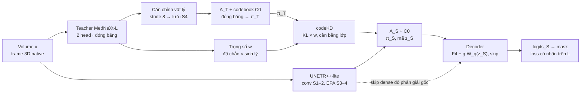

# Q-3D: Student-only quantized distillation — technical spec

Nov 11, 2026 · Alvin · bản gốc có thể sửa: [Claude Doc](https://claude.ai/artifact/A3tMfHzcbdpHqAQ9pkwZXE). Trạng thái: thiết kế, chưa có kết quả thực nghiệm.

## 1. Phạm vi và quyết định đã chốt

Q-3D là một candidate mới, nằm cạnh A-3D, theo hợp đồng **chỉ student chạy khi deploy**. Teacher MedNeXt hai head chỉ dùng lúc train. Tri thức truyền qua một codebook chung được neo theo teacher (codeKD) trên ảnh không nhãn, có trọng số theo độ nhất quán sinh lý. Student là UNETR++ rút gọn, giữ đường dense cho biên.

Nguồn tổng hợp: atlas `teacher_student_paper_architecture_vi.pdf` (10 trang), ghi chú "Thay graph bằng representation lượng tử hóa", và các chỉnh sửa đã chốt trong chat ngày 11/11/2026. Code đối chiếu: `QuocKhanhLuong/Self-Audit` `main@c7582bb`.

| Quyết định | Chốt | Thay đổi so với nguồn |
| --- | --- | --- |
| Deploy | Chỉ student, không teacher, không cascade | Bỏ khối cascade và cộng logits teacher của atlas (trang 1, 6) |
| Teacher | Một MedNeXt-L k3, hai head (region, SDF), init pretrained | Giữ atlas trang 2 |
| Interface | Codebook chung neo theo teacher, đóng băng sau khi học tokenizer | Ghi chú học codebook chung với cả hai adapter → đổi thành neo teacher |
| Residual tầng 2 ("private") | Tắt trong main, bật ở phase sau, khởi tạo đóng góp bằng 0 | Đổi tên thành residual tầng 2; không claim "private" |
| Đường dense student | Không lượng tử hóa; skip độ phân giải gốc đi thẳng tới decoder | Ghi chú cho decoder chỉ đọc mã → đổi thành ablation |
| Trọng số codeKD w\_p | Độ chắc của teacher × độ nhất quán sinh lý của bệnh nhân | Ghi chú để trống w\_p |
| Student | UNETR++-lite: conv ở stage 1–2, EPA ở stage 3–4, decoder conv nhẹ | Atlas dùng EPA mọi stage; support thích nghi A\_c/A\_d → ablation |
| Teacher trong joint | Đóng băng (main); online là ablation | Atlas cập nhật teacher xen kẽ |
| Semi cho teacher | Không trong main | Giữ atlas trang 8 |

**Non-goals (không làm trong Q-3D):** policy chọn query K1, packet/bit codec, đồ thị trạng thái tim, cascade T+S, teacher thời gian, test-time adaptation, đếm bit. A-3D giữ nguyên làm baseline; không sửa file nào trong `self_audit/candidate_a3d/` ngoài import.

**[AMEND] Trạng thái bản sửa 2026-11-12:** P0–P5 theo hợp đồng sửa này đều `NOT_RUN`; kiểm tra hàm thuần CPU/synthetic chỉ là `SOFTWARE_ONLY`. Main đã có triển khai Q3D tại `28e1a36be014a0d75272d5aca3fff18e482d3593`; kiểm tra lịch sử không chứng minh triển khai đó đáp ứng bản sửa. Chưa có kết quả bệnh nhân, GPU hay novelty. Đợt này chỉ sửa spec và khóa helper loss, không sửa engine, student, tokenizer hoặc train.

## 2. Kiến trúc tổng thể và hợp đồng tensor

Mỗi bước train chạy teacher (đóng băng) và student trên cùng một volume; teacher chỉ sinh target cho student trên lưới stage 4. Lúc deploy chỉ còn đường student: encoder, interface mã với codebook đã đóng băng, decoder.



Chỉ bốn khối E, AS, D, O chạy khi deploy.

Teacher và tokenizer đóng băng chỉ tạo π\_T và trọng số w khi train; lúc deploy chỉ còn bốn khối tô màu.

Ký hiệu: B batch, D số lát native, H×W in-plane native, h = ceil(H/16), w = ceil(W/16). Mọi tensor ảnh ở native grid, không resample, không crop, như hợp đồng hiện tại của `CandidateA3DData`.

| Tensor | Shape | Nguồn | Ghi chú |
| --- | --- | --- | --- |
| `x` | \[B,1,D,H,W\], float trong \[0,1\] | `CandidateA3DData` | Hợp đồng hiện có; có `geometry` (spacing\_zyx mm, affine) |
| `region_logits`, `boundary_logits` | \[B,4,D,H,W\] | `DualBranchTeacher3D` | Giữ nguyên |
| `sdf_T` | \[B,4,D,H,W\] | `DualBranchTeacher3D` | Code hiện có 4 kênh; atlas ghi 3 kênh — giữ 4 để không sửa teacher |
| `F_T_src` | \[B,C\_T,D\_p/8,H\_p/8,W\_p/8\] | [FIX] (§3) MedNeXt encoder `x_res_3`, stride 8 | C\_T phải đọc từ `adapter.channels`; D\_p, H\_p, W\_p là kích thước sau padding của teacher |
| `F_T_aln` | \[B,C\_T,D,h,w\] | Mục 4 | Teacher đã căn về lưới stage 4 của student |
| `u_T`, `u_S` | \[B,64,D,h,w\], chuẩn hóa L2 theo kênh | Adapter A\_T, A\_S |  |
| `C0` | \[256,64\], chuẩn hóa L2 | Tokenizer, mục 5 | Đóng băng sau tokenizer stage |
| `pi_T`, `pi_S` | \[B,256,D,h,w\] | Softmax cosine/τ | Phân bố gán mềm trên C0 |
| `cls_T4` | \[B,D,h,w\], int | [FIX] (§4) argmax phân suất region teacher trên ô S4 có tâm đúng pha | Dùng để cân bằng lớp trong codeKD |
| `logits_S` | \[B,4,D,H,W\] | Student | Đầu ra deploy duy nhất |
| `sdf_S` | \[B,4,D,H,W\] | Student, head phụ | Chỉ khi train; bỏ khi export |

Lưu ý về trục z: teacher pad mọi trục tới ≥ 32 và bội số của 16 bằng replicate ở phía cuối (`DualBranchTeacher3D._pad`), rồi downsample đẳng hướng. Với D ≈ 10, vùng dữ liệu thật chỉ chiếm khoảng 1–2 ô z ở stride 8. Student không hạ z, nên phép căn ở mục 4 nội suy teacher theo z; đây là rủi ro đã biết, ghi ở mục 13.

## 3. Teacher: MedNeXt một encoder, hai head

**[FIX]** Teacher dùng lại `DualBranchTeacher3D`, `supervised_loss` và `bank.sdf_targets`; near/far thuộc `q3d_teacher_loss` trong `self_audit/candidate_q3d/losses.py`. Không sửa hoặc merge vào `candidate_a3d.teacher_loss`. Feature main lấy trực tiếp từ encoder; hook dành cho ablation decoder.

**Cấu trúc (fact từ code):** một `MedNeXtL3DAdapter` làm encoder chung. Nhánh region là đường segmentation gốc của MedNeXt. Nhánh boundary (`_BoundaryPath3D`) đọc `features[0]` và `features[-1]`, ra `boundary_logits` và `sdf`. Hai head có lỗi tương quan vì chung trunk, nên không dùng sự đồng thuận của chúng làm tín hiệu kiểm chứng.

**Init:**

- Encoder và nhánh region từ checkpoint MedNeXt pretrained mà run k=2 hiện đang dùng. Config phải ghi `weights` và `weights_sha256`, nguồn dữ liệu pretrain, và có chồng lên ACDC/M&Ms hay không.
- Nhánh boundary khởi tạo random.

**[FIX] Loss riêng Q3D (`q3d_teacher_loss`):**

- CE + Dice foreground cho `region_logits` và cho `boundary_logits`.
- SDF cân bằng gần/xa biên theo atlas trang 2: target là khoảng cách có dấu theo mm chia R = 5 mm, kẹp về \[−1, 1\]; vùng gần là |d| < 2,5 mm; trung bình riêng vùng gần và vùng xa rồi gộp với α = 0,5; tập rỗng thì chuẩn hóa lại trọng số; lớp vắng có target +1. **[FIX]** P1 kiểm tra/triển khai trong Q3D, tái dùng `supervised_loss` và target của `bank.sdf_targets`, không merge near/far vào baseline.

**Lịch fine-tune (stage T):**

| Bước | Update | Tham số được học | LR (AdamW) |
| --- | --- | --- | --- |
| T-a | 5% đầu | Nhánh boundary; encoder và nhánh region đóng băng | 1e-3 |
| T-b | Phần còn lại | Tất cả | Encoder 1e-4, hai head 1e-3, warmup 5% rồi cosine |

**[AMEND] Param group T-b:** head region là `teacher.encoder.model.out_0`; head boundary là nhánh boundary; các tham số còn lại thuộc encoder/trunk, không trùng giữa các group.

Tổng 8.000 update (100 epoch × 80 update, giống semi profile hiện tại), chỉ trên L. Weight decay 1e-4. Augmentation theo mục 9. Chọn checkpoint theo DEV FG Dice patient-macro đã khóa trước; DEV chỉ dùng để chọn checkpoint, không dùng để tune loss.

**Trong stage joint:** teacher đóng băng hoàn toàn (`freeze_teacher: true`), chạy `torch.no_grad()` ở chế độ eval. Teacher online (cập nhật trên L, LR × 0,1, tokenizer vẫn đóng băng) là ablation O1, có đo churn của phép gán mã.

**[FIX] Feature nguồn cho tokenizer:** main dùng encoder `x_res_3`, stride 8, có sẵn tại `features[3]`, không cần hook hoặc forward thứ hai. `_native_forward_with_features` trả `(features, region_logits)`; `features` chỉ gồm `(x_res_0, x_res_1, x_res_2, x_res_3, bottleneck)`, không có decoder. Output `dec_block_3` stride 8 chuyển thành ablation; bottleneck stride 16 vẫn là S1. Nếu dùng hook, hook child cuối của `dec_block_3` vì `iterative_checkpoint` lặp theo child, bỏ qua forward của container. Test assert hook fire đúng một lần mỗi forward và đúng shape/kênh. P0 xác nhận dispatch checkpoint và tên child thực tế từ source đã pin.

## 4. Căn chỉnh vật lý teacher → lưới stage 4 của student

Teacher và student nhận cùng một volume trên cùng native grid, nên căn chỉnh vật lý rút về ánh xạ chỉ số voxel chính xác; không cần affine. Affine chỉ cần nếu sau này hai mạng nhận hai grid khác nhau.

**[FIX] Pha của mạng:** lấy tâm pixel native chỉ số 0 tại tọa độ 0. Với down conv k3 s2 p1, tâm ô stride tích lũy s nằm tại `s·k`, không phải `s·k + s/2`. Theo từng trục, bắt đầu bước lưới j = 1, offset o = 0; qua kernel k, stride a, padding trái p, dilation d:

```text
o_new = o + (d·(k−1)/2 − p)·j
j_new = a·j
```

**[FIX] Hợp đồng align:** `align_teacher_to_student4(F_T_src, native_shape, teacher_phase, student_phase)` nhận bước lưới/offset của từng mạng suy từ chuỗi kernel/stride/padding thật, kể cả padding đầu vào. Tâm student k có tọa độ native `x = o_S + j_S·k`; lấy mẫu hoặc nội suy teacher tại `(x−o_T)/j_T`. Khai báo xử lý biên, crop về `[D,h,w]`, luôn `detach()`. Không đổi grid ảnh native.

**[FIX] Lý do:** khi hai offset bằng 0, avg-pool 2×2 teacher stride 8 đặt tâm tại `16k+4`, lệch +4 px in-plane so với student `16k`. Công thức z cũ `(z+0,5)/8−0,5` lệch −0,4375 (≈0,44) ô teacher so với `z/8`. Không dùng hai công thức cũ. P0 đọc MedNeXt v1 tại source_repo/source_commit đã pin và ghi kernel/stride/padding stem, down_0..3, kể cả nhánh residual. Source đối chiếu: `MIC-DKFZ/MedNeXt@0b78ed869fbd1cc2fd38754d2f8519f1b72d43ba`.

**[FIX] Hạn chế:** receptive field teacher có thể chứa lát pad replicate; căn đúng pha không phục hồi độ phân giải z đã mất. Nguồn stride 4 vẫn là ablation.

**[FIX] Unit test bắt buộc ở P2:**

- Feature hằng → kết quả hằng.
- **[FIX]** Feature tuyến tính theo tọa độ native → đúng tâm student, sai số ≤ 1e-5 trong miền nội suy; kiểm riêng quy tắc biên.
- **[FIX] Network-phase probe:** cho ramp tọa độ native đi qua đúng chuỗi stem/down của student và MedNeXt đã pin, dùng kernel hộp đối xứng chuẩn hóa, giữ kernel/stride/padding thật. So tâm ô đo được với hàm align, sai số ≤ 0,5 px. Đo miền có receptive field nằm trong dữ liệu thật để padding không bẻ cong ramp; kiểm riêng biên. Probe phải phát hiện lệch 4 px và 0,4375 ô của công thức cũ.
- Shape đúng với D trong {6, 9, 10, 13, 20} và H, W lẻ.
- `F_T_aln.requires_grad` là False.

## 5. Tokenizer teacher và codebook chung

Codebook do teacher định nghĩa rồi đóng băng; student chỉ học dự đoán mã của teacher. Điều này chặn lời giải tầm thường khi hai adapter tự do cùng dồn mọi vị trí vào vài mã (cách BEiT v2 neo tokenizer theo teacher).

**Thành phần (`self_audit/candidate_q3d/tokenizer.py`):**

| Thành phần | Cấu hình | Sau stage tokenizer |
| --- | --- | --- |
| Adapter A\_T | Conv 1×1×1 (C\_T→128) → GELU → Conv 1×1×1 (128→64) → chuẩn hóa L2 | Đóng băng |
| Codebook C0 | K = 256 mã, d = 64, mỗi mã chuẩn hóa L2 | Đóng băng, lưu kèm version + SHA-256 |
| Decoder tái tạo R\_T | Conv 1×1×1 (64→C\_T) | Bỏ |
| Head giải phẫu H\_A | Linear 64→4 | Bỏ |

**Gán mã:** độ giống cosine giữa u và từng mã. Mã cứng = mã có cosine lớn nhất. Phân bố mềm = softmax của cosine chia τ, τ = 0,1 cố định. Chuẩn hóa L2 chặn adapter đổi độ lớn vector để làm phân bố cứng hay mềm tùy ý, và giảm mã chết (như ViT-VQGAN).

**Học codebook:**

- Khởi tạo bằng k-means++ trên u\_T của 200 volume đầu (L và U).
- Cập nhật bằng EMA của các vector được gán, decay 0,99, rồi chuẩn hóa lại L2. Đây là EMA của centroid, không phải EMA teacher tạo pseudo-label.
- Mã có tần suất dùng dưới 0,1% trung bình trong 200 update gần nhất được thay bằng một u\_T ngẫu nhiên (dead-code restart).

**Loss tokenizer (chỉ cập nhật A\_T, R\_T, H\_A; teacher đóng băng; không dùng GT):**

- Commitment: β = 0,25 nhân khoảng cách bình phương giữa u\_T và mã được gán (đã detach).
- Tái tạo: L1 giữa R\_T(mã) và F\_T\_aln đã detach, chia độ lệch chuẩn theo kênh của F\_T\_aln. Straight-through: forward dùng mã, gradient đi về u\_T.
- Giải phẫu: cross-entropy mềm giữa H\_A(mã) và phân suất lớp của ô, **[FIX] (§4)** lấy từ xác suất region teacher trên ô S4 có tâm đúng pha. Mục đích: mã mang giải phẫu, không chỉ texture. Trọng số 0,5.

**Stage Q:** 1.000 update trên L và U (ảnh U là image-only, đúng hợp đồng hiện tại), sau stage T.

**Metrics ghi mỗi 50 update:** perplexity của phân bố sử dụng mã, số mã chết, số mã chiếm đa số trong mỗi lớp teacher, churn (tỉ lệ ô đổi mã cứng giữa hai snapshot).

**Gate trước khi sang stage joint** (giá trị khởi điểm, khóa trước khi chạy): perplexity ≥ 32; mã chết ≤ 25%; mỗi lớp RV, MYO, LV có ≥ 4 mã mà phần lớn khối lượng rơi vào lớp đó. Không đạt thì dừng và báo cáo, không nới gate.

**[AMEND] Báo cáo P0 về support lớp:** chỉ trên GT của L, đo tỉ lệ ô mà mỗi lớp thắng argmax phân suất lớp tại lưới S4 đúng pha (§4); báo số ô, tần suất BG/RV/MYO/LV, tie chọn chỉ số lớp nhỏ nhất. **[OPEN] Nếu MYO < 2% tổng số ô**, gate “≥ 4 mã MYO” và cân bằng lớp MYO phải được xem lại trước P2. Dừng để xem xét thiết kế, không tự đổi ngưỡng hoặc dùng U/DEV/TEST GT.

## 6. Student UNETR++-lite

Student là UNETR++ rút gọn cho volume tim native: conv ở hai stage đầu, EPA ở hai stage cuối, không bao giờ hạ trục z, decoder conv nhẹ với skip cộng. Ngân sách: ≤ 10M tham số; đo latency GPU (bf16, batch 1) và CPU trong P1.

**Encoder** (input pad in-plane tới bội số của 16 bằng replicate ở phía cuối, crop output về; D không pad):

| Stage | Stride tích lũy (z,y,x) | Kênh | Khối | Depth |
| --- | --- | --- | --- | --- |
| F0 | (1,1,1) | 16 | Conv k(1,3,3) → conv residual k3, InstanceNorm, GELU | 1 |
| S1 | (1,2,2) | 32 | Down conv k(1,3,3) stride (1,2,2) + conv residual k3 | 1 |
| S2 | (1,4,4) | 64 | Như S1 | 1 |
| S3 | (1,8,8) | 128 | Down + khối EPA | 2 |
| S4 | (1,16,16) | 256 | Down + khối EPA | 2 |

**Khối EPA cho shape biến đổi.** EPA gốc chiếu K, V từ N token xuống P bằng ma trận tuyến tính phụ thuộc N, nên chỉ chạy với input cố định kích thước. Volume native có D, H, W khác nhau theo bệnh nhân, nên phải thay:

- Nhánh spatial: Q là toàn bộ N token; K và V được pool trung bình có mask về lưới cố định (min(D,4), 4, 4), tức P ≤ 64. Token pad không được tính vào pooling. Đây là "uniform support" của atlas trang 9.
- Nhánh channel: attention C×C tính trên token hợp lệ, Q và K chuẩn hóa L2 như bản gốc.
- 4 head; nối hai nhánh rồi chiếu về C; residual; sau đó FFN là conv depthwise k3 + conv 1×1.
- Support thích nghi A\_c/A\_d của atlas trang 4 là ablation E1, không phải main.

**Interface mã tại S4:**

- Adapter A\_S: conv 1×1×1 256→128 → GELU → 128→64 → chuẩn hóa L2, ra u\_S.
- pi\_S = softmax(cosine(u\_S, C0)/τ) với C0 và τ của teacher (đóng băng).
- Mã cứng z\_S qua straight-through. Đưa vào decoder: F4 + g · W\_q(z\_S), W\_q là conv 1×1×1 64→256, g là scalar học được, khởi tạo 0. Decoder bắt đầu từ đường liên tục, rồi tự học dùng mã.
- Ablation "chỉ mã" (B1): decoder chỉ nhận W\_q(z\_S), bỏ F4 và mọi skip. Đây là dạng nút cổ chai kiểu A-3D.

**Decoder:** mỗi bước upsample (1,2,2) trilinear + conv 1×1×1 giảm kênh, cộng skip cùng stage, một khối conv residual k3. Chuỗi kênh 256→128→64→32→16. Head: conv 1×1×1 16→4 ra `logits_S`; head SDF 16→4 với tanh ra `sdf_S`, chỉ khi train. Không dùng deep supervision trong main.

**Tối ưu triển khai:** bf16 autocast khi train và infer; layout `channels_last_3d` cho conv; `F.scaled_dot_product_attention` cho nhánh spatial; `torch.compile` tùy chọn; infer cả volume một lần, không sliding window.

**Nếu vượt 10M tham số:** giảm kênh S4 xuống 192 trước, rồi S3 xuống 96. Không cắt F0 và skip độ phân giải gốc.

## 7. Toàn bộ loss và đường gradient

Student học từ bốn loss: hai loss có nhãn trên L, codeKD trên U (và L), commitment. Teacher và codebook không nhận gradient nào trong stage joint.

| ID | Stage | Dữ liệu | Loss | Trọng số khởi điểm | Cập nhật |
| --- | --- | --- | --- | --- | --- |
| T1 | T | L | CE + Dice foreground, `region_logits` | 1 | Teacher |
| T2 | T | L | CE + Dice foreground, `boundary_logits` | 1 | Teacher |
| T3 | T | L | SDF cân bằng gần/xa (mục 3) | 1 | Teacher |
| Q1 | Q | L + U | Commitment u\_T với mã được gán | β = 0,25 | A\_T |
| Q2 | Q | L + U | Tái tạo F\_T\_aln, L1 chuẩn hóa theo std kênh | 1 | A\_T, R\_T |
| Q3 | Q | L + U | Cross-entropy mềm với phân suất lớp teacher theo ô | 0,5 | A\_T, H\_A |
| S1 | Joint | L | CE + Dice foreground, `logits_S` | 1 | Student |
| S2 | Joint | L | SDF cân bằng gần/xa, `sdf_S` | λ\_d = 1 | Student |
| S3 | Joint | U (chính) + L | codeKD cân bằng lớp, nhân w (mục 8) | λ\_k = 1, ramp tuyến tính 0→1 trong 10% update đầu | Encoder student, A\_S |
| S4 | Joint | L + U | Commitment u\_S với mã cứng của chính nó | β = 0,25 | Encoder student, A\_S |

Tổng stage joint: S1 + λ\_d · S2 + r(t) · λ\_k · S3 + S4.

**[FIX] codeKD (S3), theo từng frame f của bệnh nhân p.** Đặt `ell_i = KL(sg(pi_T(i)) || pi_S(i))`; chỉ w_cell tham gia trung bình trong lớp:

```latex
s_{f,c}=\sum_{i:\mathrm{cls}_{T,f}(i)=c}w_{\mathrm{cell},f,i},\qquad
\mathcal C_f=\{c:s_{f,c}>0\},
B_f=\frac{1}{|\mathcal C_f|}\sum_{c\in\mathcal C_f}
\frac{\sum_{i:\mathrm{cls}_{T,f}(i)=c}w_{\mathrm{cell},f,i}\,\ell_i}{s_{f,c}},
\qquad L_f=\omega_p B_f.
```

**[FIX]** Không có epsilon hay w_pat trong mẫu số. Trung bình đều các lớp có tổng w_cell > 0, kể cả BG. Lớp có tổng bằng 0 bị loại khỏi C_f và ghi log, không pha loãng mẫu số. Nếu C_f rỗng, trả loss 0 hữu hạn vẫn giữ autograd graph, gradient student bằng 0 như nhánh rỗng của `consistency_loss`.

**[FIX] Lý do:** công thức cũ đặt w_cell·w_pat ở cả tử và mẫu nên triệt tiêu trọng số bệnh nhân. Probe CPU/synthetic cho loss/grad xấp xỉ 1,000× (làm tròn ba chữ số) khi w_pat ∈ {1, 0.1, 1e-4}; epsilon chỉ phá tính bất biến gần 0. Nó thực chất tạo cổng cứng ẩn ở r_SV ≈ 6–7τ, phụ thuộc tổng support/epsilon. Đây là `SOFTWARE_ONLY`, không phải bằng chứng bệnh nhân.

**[AMEND] Ramp:** `r(t) = min(1, t/800)`, t là số optimizer update đã hoàn thành trước update hiện tại (0-based), tăng từ 0 tới 1 trong 10% của 8.000 update J. Resume lưu t. Không dùng `candidate_a3d.semisupervised.ramp_weight` vì hàm đó nhận epoch. Một cặp L/U tích lũy hai luồng rồi một optimizer step: 8.000 cặp L/U = 8.000 optimizer step.

**[AMEND] Hợp đồng hàm thuần trước P0–P5:**

- `weighted_class_balanced_reduce(per_cell_loss, cls, w_cell, omega) -> (loss, stats)` nhận loss `[D,h,w]` hoặc `[B,D,h,w]`; cls/w_cell cùng `[D,h,w]`. Khi có B, áp map chung cho từng frame rồi mean các loss frame; cohort thật với map khác nhau gọi riêng từng frame. Validate shape, finite, lớp nguyên BG/RV/MYO/LV, w_cell ≥ 0 và omega ≥ 0; weights detach. Stats ghi lớp active/excluded, tổng trọng số lớp, base loss và omega.
- `cohort_omega(w_pat, arm) -> dict` trả `omega` (patient → float), `mean_w_pat`, `ess`, `ess_fraction`, `mean_omega`, `max_omega`, `zero_fraction`. Đầu vào U không rỗng, weights finite/nonnegative. V1/C1 và V1-u dùng cùng cohort U đủ gate §8; V1-u chỉ bỏ trọng số tương đối. `arm="L"` trả omega = 1 và không áp gate U. Không trộn L/U trong một đầu vào.
- `tests/test_candidate_q3d_weighting.py` khóa tỉ lệ loss/grad 1:0,1:0; anti-regression công thức cũ; ví dụ tay; zero-support không pha loãng; all-zero giữ graph; mean omega/ESS/gate; L/V1-u; weights bằng nhau cho V1/V1-u trùng từng bit. Chỉ thêm helpers, giữ API loss đang có trên main; tích hợp vào engine thuộc P4 `NOT_RUN`.

**Đường gradient:**

- Teacher chạy `no_grad`, eval mode; `pi_T`, `cls_T4`, w đều detach.
- C0 là buffer, không phải parameter; student không cập nhật codebook.
- Straight-through tại S4: forward dùng mã cứng, gradient của S1 và S2 đi qua W\_q về u\_S.
- Test tự động: sau một bước joint, mọi tham số teacher, A\_T và C0 không đổi từng bit.

## 8. Trọng số w: độ chắc của teacher × độ nhất quán sinh lý

**[FIX]** w_cell chỉ dùng trong reducer theo lớp (§7); omega nhân bên ngoài. w_pat đo tính nhất quán sinh lý của mask teacher, không học từ K bệnh nhân có nhãn và không dùng metadata ED/ES. **Frame L: omega = 1 ở mọi arm. U V1/C1: omega_p = w_pat(p)/mean_U(w_pat). U V1-u: omega ≡ 1.** Mean tính một lần trên toàn bộ bệnh nhân U trong cache đóng băng, không theo minibatch/frame, không chuẩn hóa lại ở từng lớp.

**w\_cell:** trung bình trên các voxel của ô của xác suất lớn nhất trong `region_logits` teacher. Nếu nhỏ hơn 0,7 thì w\_cell = 0, ngược lại bằng chính giá trị đó (0,7 là ngưỡng đang dùng trong semi profile).

**w\_pat, tính một lần cho mỗi snapshot teacher (`self_audit/candidate_q3d/physiology.py`):**

1. Chạy teacher (`no_grad`) trên mọi frame cine của bệnh nhân U. Thể tích mỗi lớp LV, RV, MYO theo mL = tổng xác suất softmax × thể tích voxel (tích spacing\_zyx / 1000).
2. ED = frame có thể tích LV lớn nhất; ES = frame nhỏ nhất. Không đọc metadata, đúng hợp đồng `unlabeled_frame_keys`.
3. Thể tích tống máu mỗi thất = thể tích ED trừ ES. Phần dư r\_SV = chênh lệch tuyệt đối giữa thể tích tống máu LV và RV, chia trung bình của hai giá trị.
4. Phần dư r\_M = chênh lệch tuyệt đối thể tích MYO giữa ED và ES, chia trung bình của hai giá trị.
5. w\_pat = exp(−½ (r\_SV/τ\_SV)²) × exp(−½ (r\_M/τ\_M)²). Khởi điểm τ\_SV = 0,15 và τ\_M = 0,10; P0 kiểm trên GT của L (trong ngân sách K) rồi khóa.

**Chặn ca teacher hỏng (w\_pat = 0):** thể tích tống máu LV ≤ 0; thể tích LV ED < 10 mL; EF LV ngoài \[5%, 90%\]. Các ngưỡng này là kiểm tra hợp lý thô, không phải tiêu chuẩn lâm sàng.

**Cổng theo dataset:** cờ `physio.stroke_balance` trong config. Tắt cho dataset có hở van ba lá hoặc thông liên nhĩ theo thiết kế (M&Ms-2), khi đó chỉ còn thành phần khối cơ tim. Dataset chỉ có ED/ES (không có cine) vẫn tính được nếu biết hai frame; dataset không có nhãn RV thì tắt thành phần tống máu.

**[FIX] Cache:** mỗi bệnh nhân một dòng JSON gồm id, SHA checkpoint teacher, đường thể tích theo frame, chỉ số ED/ES, r\_SV, r\_M, w\_pat; metadata cache ghi cohort U, N_U, mean_U(w_pat), ESS, ESS/N_U; file cache có SHA-256. Teacher đóng băng nên chỉ tính một lần trước joint; O1 tính lại mỗi 10 epoch và mỗi snapshot mới phải tính lại mean/gate.

**[FIX] Gate trước joint, khóa trước khi dùng kết quả:** chỉ dùng w_pat trên U: `mean_U(w_pat) > 0` và `ESS/N_U = (Σw)²/(N_U·Σw²) ≥ 0,25`. Không đạt thì dừng, không nới. **Log mỗi run:** mean(omega) (phải bằng 1 trên mỗi vòng U đầy đủ, mỗi bệnh nhân góp một lần), max omega, tỉ lệ omega = 0, ESS và ESS/N_U. L không tham gia mẫu số U. Gate không dùng kết quả arm hoặc DEV/TEST. V1-u dùng cùng cohort đủ gate để so sánh trọng số tương đối công bằng.

**Chẩn đoán (chỉ báo cáo):** tính w\_pat trên bệnh nhân DEV và báo tương quan Spearman với Dice RV và HD95 thật của teacher. Không dùng số này để chọn τ.

## 9. Dữ liệu, protocol nhãn và lịch train

Protocol chính là A: K bệnh nhân có nhãn cho cả hệ, phần TRAIN còn lại là U image-only. Kết quả chính ở K = 5 và 10; K = 2 là stress test; một seed (42).

**Protocol:**

|  | A (chính) | B (tham chiếu) |
| --- | --- | --- |
| Teacher dùng GT | K bệnh nhân | Toàn bộ TRAIN |
| Student dùng GT | Cùng K | K bệnh nhân |
| U | TRAIN còn lại, image-only | TRAIN còn lại, image-only với student |
| Claim | Hiệu quả ít nhãn của cả hệ | Trần khi teacher mạnh |

Không chia sẻ checkpoint, cache sinh lý hay codebook giữa A và B. Pretraining ngoài của MedNeXt phải khai báo ở cả hai.

**Dataset:** ACDC và M&Ms gốc trước, mỗi bộ train và test riêng; sau đó hai bộ CMR còn lại (chưa xác định tên). Test chéo: train ACDC, test M&Ms và hai bộ kia. Dùng manifest và split đã khóa hiện có. Lưu ý: log campaign trước ghi M&Ms còn bị chặn bởi 34 affine không tương thích geometry.

**Sampler stage joint:** mỗi update gồm một frame L (ED hoặc ES có nhãn) và một frame U (frame bất kỳ của một bệnh nhân U, lấy đều theo bệnh nhân). Batch 1 mỗi luồng vì shape native khác nhau; tích lũy gradient 2.

**Augmentation** (trong loader, cùng một phép biến đổi không gian cho ảnh, mask và cả hai đầu vào teacher/student):

- Lật y, lật x, mỗi cái xác suất 0,5. Xoay 90° in-plane chỉ khi spacing y và x bằng nhau (sai số 1e-3), và đổi geometry tương ứng.
- SDF tính lại từ mask đã biến đổi, không biến đổi SDF cũ.
- Cường độ: dùng `strong_intensity` hiện có (gamma \[0,7; 1,5\], nhiễu std 0,03), xác suất 0,5 trên L.
- Trên U cho codeKD: teacher nhận ảnh không augment cường độ, student nhận bản có `strong_intensity`; không gian giống nhau.
- Lật trái–phải đổi phía của RV so với LV, điều không xảy ra trong SAX thật. Giữ vì nnU-Net cũng mirror mặc định, nhưng ghi lại là một lựa chọn có thể đảo.

**Optimizer student:** AdamW, LR 3e-4 (bằng `student_lr` hiện tại), weight decay 1e-4, warmup 5% rồi cosine, gradient clip 1,0, bf16.

**Lịch:**

| Stage | Nội dung | Update | Teacher |
| --- | --- | --- | --- |
| T | Fine-tune teacher trên L (mục 3) | 8.000 | Học |
| Q | Học tokenizer trên L + U (mục 5), rồi kiểm tra gate | 1.000 | Đóng băng |
| P | Tính cache sinh lý trên U (mục 8) | Một lượt forward | Đóng băng |
| J | Student joint (mục 7) | 8.000 | Đóng băng |

Chọn checkpoint student theo DEV FG Dice patient-macro, đánh giá mỗi 400 update. Mỗi stage ghi checkpoint, SHA-256 và có thể resume.

## 10. Hợp đồng deploy: chỉ student

Artifact export chỉ chứa tham số student, adapter A\_S, W\_q, scalar g và buffer C0 đã đóng băng. Không có tham số, tensor, cache hay codebook version nào khác của teacher.

- **Input:** một frame 3D \[1,1,D,H,W\] trong \[0,1\] và `geometry` (spacing\_zyx, affine), cùng chuẩn hóa với lúc train.
- **Output:** `logits_S` \[1,4,D,H,W\] trên native grid, argmax ra mask BG/RV/MYO/LV.
- **Bỏ khi export:** head SDF, R\_T, H\_A, A\_T, cache sinh lý.
- **Không có lúc test:** teacher, nhãn support, optimizer, test-time adaptation, cine của bệnh nhân.
- **Kiểm tra cold-load:** nạp artifact vào process mới không import module teacher; dự đoán phải trùng từng bit với dự đoán lúc train-time eval trên 3 volume DEV.
- **Manifest export:** SHA-256 artifact, SHA C0 và version, commit code, tham số, latency GPU/CPU đo được.

## 11. Ablation, baseline, metrics và quy tắc quyết định

Bốn arm chính trả lời ba câu hỏi: VQ có hơn KD liên tục không, teacher có giúp không, trọng số sinh lý có giúp không. Mọi arm dùng cùng student, decoder, dữ liệu, số update và seed.

| Arm | Interface | Teacher signal | w\_pat | Trả lời |
| --- | --- | --- | --- | --- |
| C0 | Liên tục, không có đường mã | Không | — | Mốc student thuần |
| C1 | [FIX] Liên tục; A\_S khớp F\_T\_aln bằng cosine, cùng reducer §7 và omega với V1 | KD feature liên tục | U chuẩn hóa; L = 1 | VQ có cần không (so V1) |
| V1 | VQ, C0 teacher đóng băng | codeKD | [FIX] U chuẩn hóa; L = 1 | **Đề xuất** |
| V1-u | Như V1 | codeKD | [FIX] omega ≡ 1 trên cả L/U | Sinh lý có cần không |

Ablation phụ, chỉ chạy khi bốn arm chính xong: V0 (VQ, không codeKD; hoàn tất bảng 2×2 của atlas), B1 (decoder chỉ đọc mã), E1 (EPA support thích nghi), O1 (teacher online), S1 (nguồn teacher là bottleneck stride 16). **[FIX] (§3)** Thêm ablation nguồn decoder `dec_block_3` stride 8; main dùng encoder `x_res_3`.

**Baseline:** A-3D `teacher_free` hiện có; Mean Teacher với cùng UNETR++-lite (dùng hạ tầng EMA có sẵn); MedNeXt-L supervised chỉ với K nhãn, báo như mốc nặng.

**Metrics:**

- Dice từng lớp RV, MYO, LV và FG mean, patient-macro.
- HD95 và ASSD (mm) theo evaluator 3D hiện có.
- Chỉ số lâm sàng trên ED/ES của bệnh nhân test: sai số EDV, ESV, EF của LV và RV; sai số khối cơ tim (thể tích MYO × 1,05 g/mL).
- Harm rate so với C0: tỉ lệ bệnh nhân có FG Dice giảm hơn 0,02.
- Chi phí: tham số, FLOPs, VRAM đỉnh, latency GPU và CPU trên một volume.
- Codebook: perplexity, mã chết, tỉ lệ mã cứng của student trùng teacher trên DEV.
- Sinh lý: tương quan Spearman giữa w\_pat và Dice RV thật trên DEV.

**Quy tắc quyết định (khóa trước khi chạy; ngưỡng là khởi điểm):** so sánh paired theo bệnh nhân trên TEST, kèm tỉ lệ bệnh nhân thắng và bootstrap CI 95% theo bệnh nhân.

- VQ đóng góp nếu V1 hơn C1 ≥ 1,0 điểm FG Dice và HD95 không tệ hơn.
- Teacher đóng góp nếu V1 hơn C0 theo cùng tiêu chí.
- Sinh lý đóng góp nếu V1 hơn V1-u, hoặc harm rate giảm rõ.
- Không đạt điều nào thì báo NO-GO cho điều đó, không đổi ngưỡng sau khi xem kết quả.

## 12. Phase triển khai cho coding agent

Code mới nằm trong `self_audit/candidate_q3d/` và `configs/candidate_q3d/`; chỉ import từ `candidate_a3d`, không sửa nó. Mỗi phase kết thúc bằng test xanh, báo cáo và một subagent review độc lập trước khi sang phase sau.

| Phase | Mục tiêu | File chính | Acceptance | Dừng khi |
| --- | --- | --- | --- | --- |
| P0 | [FIX] [AMEND] Read-only, không train | `scripts/q3d_preflight.py` | JSON: source_repo/commit MedNeXt v1; kernel/stride/padding stem và down_0..3, pha native; x_res_3/C_T; iterative_checkpoint và child cuối dec_block_3; near/far thuộc Q3D; D/spacing; r_SV/r_M GT L; tham số student; tần suất argmax phân suất GT L ở S4 đúng pha (§5) | Thiếu module/C_T sai: dừng; [OPEN] MYO < 2%: xem lại coverage/balancing trước P2, không tự nới |
| P1 | [AMEND] Đăng ký track riêng, student + C0, q3d_teacher_loss | `student.py`, `config.py`, `engine.py` (nhánh C0), `losses.py` | Test shape với H, W lẻ và D ∈ {6, 9, 10, 13, 20}; pad rồi crop trả đúng kích thước; đổi giá trị vùng pad không làm đổi output vùng hợp lệ; ≤ 10M tham số; báo latency GPU/CPU; C0 chạy được trên synthetic fixture và smoke ACDC; đăng ký track như dưới | Vượt 10M sau khi đã giảm kênh theo mục 6 |
| P2 | [FIX] Căn chỉnh theo pha + tokenizer | `alignment.py`, `tokenizer.py`, `teacher_features.py` (main lấy x_res_3; hook child cuối chỉ cho ablation) | Test §4 gồm network-phase probe ≤ 0,5 px; hook fire đúng một lần/forward và đúng shape; EMA codebook, dead-code restart, đóng băng; metric/gate §5 | Gate tokenizer không đạt trên ACDC |
| P3 | [FIX] Cache sinh lý và mean/ESS U | `physiology.py`, `scripts/q3d_physio_cache.py` | Cine ellipsoid tổng hợp: đúng ED/ES, r_SV, r_M, guard; cache SHA và mean/ESS; omega/gate §8 đúng | Mean U = 0 hoặc ESS/N_U < 0,25 |
| P4 | [FIX] Stage joint + arm C1, V1, V1-u | `losses.py`, `engine.py`, `configs/candidate_q3d/{c0,c1,v1,v1u}.json` | Teacher/A_T/C0 không đổi từng bit; reducer/omega đúng §7–8, C1 cùng hợp đồng; zero support giữ graph; ramp theo optimizer update; resume giữ nguyên kết quả | Loss NaN hoặc perplexity student sập |
| P5 | Evaluate + export | `evaluation.py` (chỉ số lâm sàng), `export.py` | Cold-load không import teacher, trùng từng bit; bảng chi phí; manifest export | — |

**[AMEND] Đăng ký track thuộc P1 (chưa làm trong đợt khóa helper):** `train.py` dispatch method `candidate_q3d`; `ACTIVE_PIPELINE.json` có `tracks.candidate_q3d`, inference “student only; dense path + frozen code interface”; `scripts/check_repo.py` validate `configs/candidate_q3d`. Q3D là track riêng, không phải A/A-3D, nên dense decoder không vi phạm điều khoản code-only decoder của A/A-3D trong AGENTS.md. Main đã có đăng ký track; xác nhận đầy đủ theo bản sửa thuộc P1 `NOT_RUN`. Near/far chỉ thuộc Q3D, không sửa baseline.

**[AMEND] Phạm vi lần sửa này:** spec và hai helper thuần/test CPU là `SOFTWARE_ONLY`; P0–P5, network-phase probe, GPU, dữ liệu thật và campaign theo bản sửa đều `NOT_RUN`. Giữ API Q3D đang có; checker chỉ thêm tên test khóa hợp đồng vào allowlist.

**Campaign sau P5:** ACDC K = 5 cho bốn arm chính trước, rồi K = 10, rồi K = 2; sau đó M&Ms và test chéo. Một seed.

**Yêu cầu báo cáo mỗi phase:** commit SHA đã push và xác nhận trên remote; danh sách test và kết quả; mọi mục chưa làm ghi `NOT_RUN` hoặc `SOFTWARE_ONLY`; không thay dữ liệu thật bằng synthetic mà không ghi rõ; không đổi config, cohort hay metric sau khi xem kết quả.

## 13. Câu hỏi mở, non-claims và prior art

**Câu hỏi mở:**

- Hai bộ CMR còn lại là bộ nào; có cine đầy đủ và nhãn RV không (quyết định cổng sinh lý).
- Checkpoint MedNeXt pretrained đang dùng là gì, dữ liệu pretrain có chồng lên ACDC/M&Ms không.
- Độ phân giải z của feature teacher stride 8 có đủ không (mục 4); nếu không, chuyển nguồn sang stride 4.
- τ\_SV và τ\_M thực tế trên GT; dung sai sinh lý ở các nhóm bệnh của ACDC.
- M&Ms còn bị chặn bởi 34 affine; cần sửa trước campaign M&Ms.

**[OPEN] Giả thuyết cần kiểm tra, không đổi design:**

- g ≈ 0 có thể khiến decoder bỏ qua mã. Log g và `‖g·W_q(z)‖/‖F4‖` mỗi 400 optimizer update, khai báo trường hợp mẫu số bằng 0. Nếu ratio < 0,05 thì không claim về interface.
- Prior sinh lý có thể phạt bệnh lý: báo w_pat theo nhóm bệnh ACDC trên DEV, chỉ báo cáo, không tune gate/ngưỡng.
- Commitment S4 có thể xung đột với codeKD trên U; chưa đổi loss/trọng số.

**Spec này không claim:**

- VQ, codebook chung, residual VQ, KD qua phân bố gán prototype đều đã có. codeKD về cơ chế giống SwAV/DINO, chỉ khác là áp giữa hai backbone 3D tại từng vị trí vật lý.
- UNETR++-lite vẫn hình chữ U; yêu cầu "student không U-Net" chưa được đáp ứng.
- Chưa có kết quả bệnh nhân, GPU, SOTA hay novelty đã chứng nhận.
- Ứng viên novelty duy nhất còn lại trong spec: dùng ràng buộc sinh lý (không học từ K bệnh nhân) để chọn cái gì được distill trên U. Chưa quét kỹ prior art cho ý này.

**Prior art gần nhất:**

| Công trình | Trùng ở đâu |
| --- | --- |
| [UNETR++](https://arxiv.org/abs/2212.04497) | Khối EPA, backbone student |
| [BEiT v2](https://arxiv.org/abs/2208.06366) | Tokenizer neo theo teacher, student dự đoán mã |
| [SwAV](https://arxiv.org/abs/2006.09882), [DINO](https://arxiv.org/abs/2104.14294) | KL giữa phân bố gán trên prototype chung |
| [ViT-VQGAN](https://arxiv.org/abs/2110.04627) | Mã chuẩn hóa L2, giảm mã chết |
| [RQ-VAE](https://openaccess.thecvf.com/content/CVPR2022/html/Lee_Autoregressive_Image_Generation_Using_Residual_Quantization_CVPR_2022_paper.html) | Residual tầng 2 |
| [Codebook-Guided Cross-Modal KD](https://arxiv.org/abs/2609.37243) | Chọn mã teacher theo độ hữu ích và tương thích student |
| [MedNeXt](https://arxiv.org/abs/2303.09975) | Backbone teacher |
| [M&Ms-2 dataset](https://zenodo.org/record/4573984) | Bệnh lý làm sai cân bằng tống máu |

Nguồn nội bộ: atlas `teacher_student_paper_architecture_vi.pdf`; ghi chú "Thay graph bằng representation lượng tử hóa"; các bản nghiên cứu vòng 1–3 trong Project, thư mục `research/2026-11-11-novelty-foundations/`.


## Thay đổi 2026-11-12

Lịch sử thiết kế gốc ngày 11/11 được giữ trong git. Đối chiếu source baseline tại main `28e1a36`; kiểm tra lịch sử không thay thế kiểm chứng hợp đồng mới.

- **[FIX] A1 — §7:** thay w_cell·w_pat trong tử/mẫu và epsilon bằng mean lớp có support rồi nhân omega ngoài; zero support giữ graph. Ghi lại lỗi triệt tiêu/cổng ẩn.
- **[FIX] A2 — §8/§11 (hợp đồng §7):** L = 1; U V1/C1 chuẩn hóa mean cache, V1-u = 1; gate mean/ESS và log; C1 cùng reducer/omega.
- **[FIX] A3 — §4, P0/P2 §12:** thay tâm nửa ô, avg-pool lệch 4 px và z lệch 0,4375 ô bằng pha mạng thật; inventory source và network-phase probe.
- **[FIX] A4 — §3 (tensor §2, ablation §11, P0/P2 §12):** main decoder stride 8 đổi sang encoder x_res_3; decoder thành ablation, hook child cuối một lần/forward.
- **[FIX] A5 — §3/§12:** near/far thuộc q3d_teacher_loss, tái dùng supervised_loss/bank.sdf_targets; không merge baseline.
- **[AMEND] A6 — §12 P1:** đăng ký track Q3D riêng, inference dense + frozen code interface, dispatch/config validation; chưa triển khai trong đợt khóa helper.
- **[AMEND] A7 — §7/§3:** ramp optimizer update; 8.000 cặp L/U = 8.000 step; region head encoder.model.out_0.
- **[AMEND] A8 — §5/§12 P0; [OPEN]:** tần suất argmax phân suất GT L ở S4 đúng pha; MYO < 2% phải xem lại coverage/balancing trước P2, không tự đổi ngưỡng.
- **[OPEN] A9 — §13:** decoder bỏ qua mã, prior phạt bệnh lý, commitment xung đột codeKD; logging/giới hạn claim, chưa đổi design.
- **[AMEND] Phần mềm — §1/§7/§12:** hai helper và test SOFTWARE_ONLY, giữ API main hiện có; P0–P5 bản sửa/GPU/dữ liệu thật NOT_RUN. Prompt chưa cung cấp nội dung riêng mang nhãn F5–F8; đã đối chiếu các mệnh đề code cụ thể ở A3–A7, không tự gán nhãn fact.
