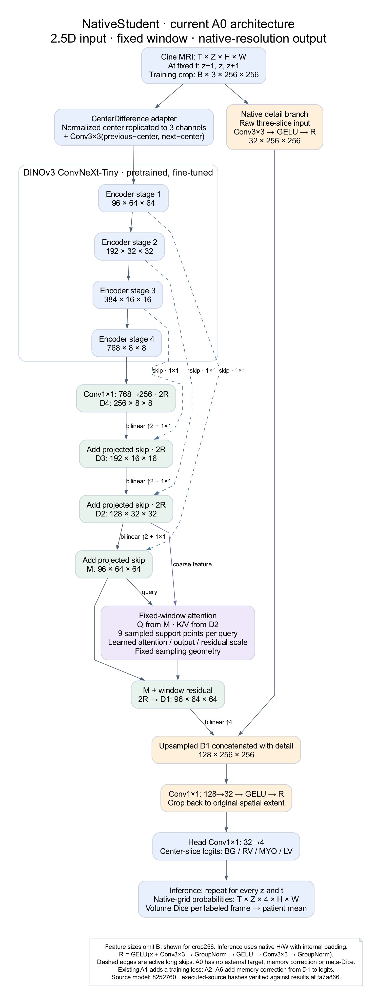
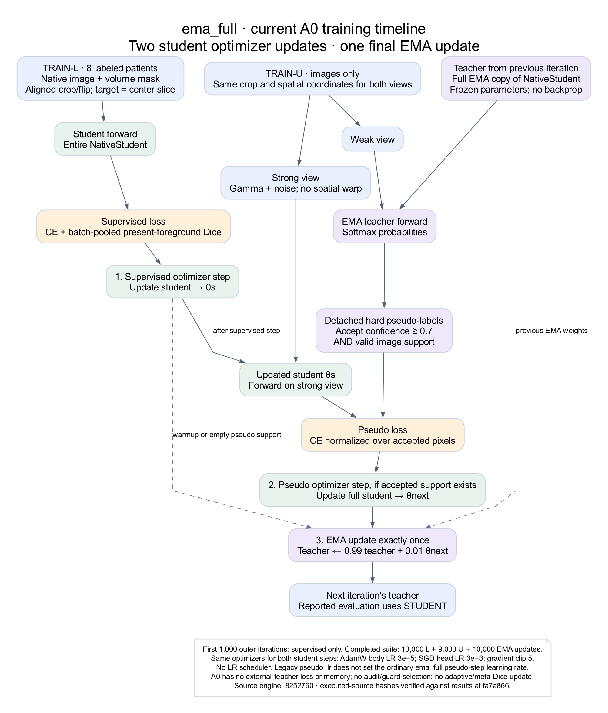

# NativeStudent to 3D: Astra handoff

This directory publishes the implementation prompt and two **current-system** figures requested on 26 October 2026. It does not implement the proposed 3D methods or report new training results.

- [Full implementation prompt for Astra](ASTRA_IMPLEMENTATION_PROMPT.md)
- [Current NativeStudent architecture — PNG](figures/native-student-current.png) · [SVG](figures/native-student-current.svg) · [DOT source](figures/native-student-current.dot)
- [Current full-EMA training — PNG](figures/ema-full-training.png) · [SVG](figures/ema-full-training.svg) · [DOT source](figures/ema-full-training.dot)
- [Publication verification](VERIFICATION.md)





The figures describe A0 from the completed A0–A6 experiment: NativeStudent, fixed-window and ema_full, with batch24/crop256. They do not depict the separate canonical `joint_guard` default or proposed 3D modules. A0 has no external teacher loss or memory correction. The repository retains the optional historical arms.

Data preparation already preserves image/mask indexing and samples the center mask with its neighboring image slices. Evaluation already aggregates predictions into a 3D frame before Dice. The 3D research question concerns depth context and joint learning, not a demonstrated misalignment repair.

## Provenance

- Handoff base: `fa7a8664621f5540e755e7869051fa25b3926cba`, `experiments/teacher-memory-full-20261024`.
- Executed model-source baseline: `8252760092e5dc97e0c441bd2d3d306146dcff64`.
- Compare `self_audit/model.py`, `window.py`, `data.py`, `losses.py`, `engine.py` and `evaluation.py` with `reports/teacher_memory_full_20261024/completed_20261025/ASSET_LINEAGE.json`.
- Current architecture: `self_audit/model.py:49`; fixed-window: `self_audit/window.py:183`; training: `self_audit/engine.py`; geometry/data: `prepare_acdc.py` and `self_audit/data.py`.

## Regenerate both figures

Requires Graphviz `dot`; no model, data, GPU or Python package is needed. From the repository root:

```bash
dot -Tpng -Gdpi=160 docs/native_3d/figures/native-student-current.dot -o docs/native_3d/figures/native-student-current.png
dot -Tsvg docs/native_3d/figures/native-student-current.dot -o docs/native_3d/figures/native-student-current.svg
dot -Tpng -Gdpi=160 docs/native_3d/figures/ema-full-training.dot -o docs/native_3d/figures/ema-full-training.png
dot -Tsvg docs/native_3d/figures/ema-full-training.dot -o docs/native_3d/figures/ema-full-training.svg
```

Font/rendering differences across Graphviz versions may change image bytes; DOT sources preserve the semantics. The implementation task keeps all experimental paths opt-in and permits bounded verification only. Long training and patient efficacy remain unrun by this handoff.
