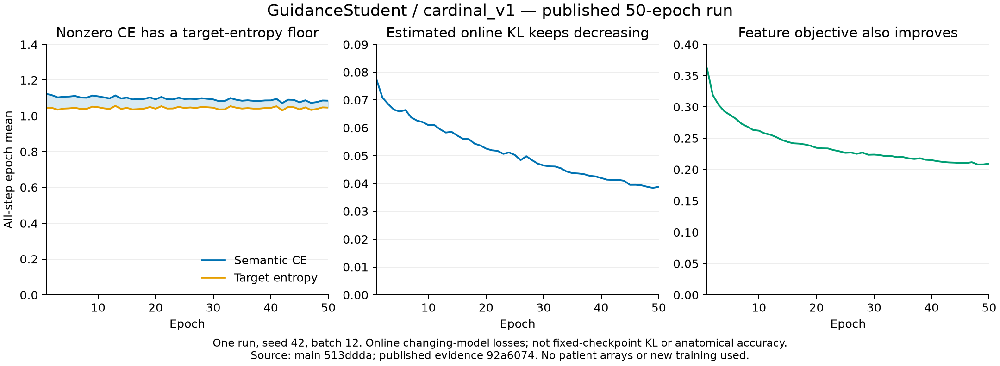

# Phân tích hội tụ — hội đồng bốn Astra, 2026-10-16

**Kết luận:** run đã giảm sai số đối với mục tiêu được giao, nhưng mục tiêu/nguồn giám sát
và phép xuất nhãn chưa tạo được segmentation hữu ích. Chưa có đủ bằng chứng kết
luận optimizer không hội tụ, teacher là nguyên nhân duy nhất, hoặc đổi sang model
Astra sẽ sửa được vấn đề. Ưu tiên tiếp theo là đo cùng nguồn, cùng grid để tách
lỗi target khỏi lỗi student, trước khi thay kiến trúc hay tăng epoch.

## Run nào đang được đánh giá?

- Đã pull `main` tới `92a60744efef85558d7c0226c84b7c49d47217ec`.
- Source thực thi được công bố là `513ddda8cec3a166f13cfe68fe6379cab014a1a7`:
  **GuidanceStudent 351.268 tham số**, frozen CineMA, geometry `cardinal_v1`,
  batch 12, seed 42, 50 epoch, 85.700 optimizer updates.
- Run này **chưa dùng** kiến trúc layer-guided Astra ở commit `2c57960`, chưa dùng
  target Z hoặc orientation `world_left_v2`. Không gán kết quả run này cho chúng.
- Cả bốn subagent được yêu cầu chạy model `gpt-6-astra`, phân tích độc lập rồi
  phản biện trực tiếp. [Provenance](COUNCIL.json) ghi rõ mức quan sát model mà
  API cung cấp; [biên bản phản biện](PEER_REVIEW.md) giữ các ý kiến được sửa và
  những bất đồng chưa phân xử.

Worktree phân tích riêng: `.worktrees/convergence-audit-20261016`; baseline,
source thực thi và historical runs không bị sửa. [Nguồn run](../stable_guidance_main513ddda_b12_20261016/README.md).

## Điều đã kiểm tra được

Probe local xác minh **118/118 published files** theo SHA/size, **24/24 archived
source files** trùng commit thực thi, và tính lại metric từ TP/FP/FN đã lưu.
Điều này xác minh publication và phép tính; không thay thế việc đọc lại ảnh,
checkpoint hay bank arrays. Replay 80 bank files và 14 frame/cine identities là
evidence **đã báo cáo từ host chạy**, chưa thực hiện lại trên máy này.
[Receipt kiểm toán](checks/published_evidence.json).

| Đại lượng | Epoch 1 | Epoch 50 | Diễn giải |
| --- | ---: | ---: | --- |
| Semantic CE | 1,123137 | 1,085173 | Không cần về 0 với target mềm |
| Weighted target entropy | 1,046016 | 1,046319 | Thành phần floor giữ gần ổn định |
| CE − entropy, online KL ước tính | 0,077121 | 0,038853 | Giảm 49,62%; không phải fixed-checkpoint KL |
| Feature loss | 0,361056 | 0,209630 | Giảm 41,94% |

KL trung bình 10 epoch cuối còn giảm khoảng 9,22% so với 10 epoch liền trước.
Không có chuỗi VAL accuracy qua nhiều checkpoint hoặc gradient-norm curve để
khẳng định stationary convergence. Các solver của bank báo numerical convergence
cho 80/80 TRAIN patients; đó là bài toán khác với named anatomy correctness.

VAL cuối vẫn rất yếu: Dice foreground **3,1896%**, recall **2,5163%**, coverage
macro **0,4960%**, UNKNOWN **99,5040%**. Đặc biệt, tổng RV được xuất là **21.449**
voxel, gồm **14 TP và 21.435 FP**. Đây là pooled counts để chẩn đoán; macro RV
precision **0,02832%** được tính theo frame→patient và chỉ 11 bệnh nhân có mẫu số
xác định. Không trộn hai cách tổng hợp. UNKNOWN khác BG; chỉ có 294 BG predictions,
nên không có căn cứ gọi hiện tượng này là collapse toàn bộ sang background.

## Các giả thuyết và mức bằng chứng

| Giả thuyết | Điều đã biết / điều chưa biết | Phép kiểm phân biệt và hướng sửa |
| --- | --- | --- |
| **Nguồn đặt tên RV/MYO/LV sai hoặc chưa đủ đặc hiệu** | Tên đến từ cluster, enclosure, intensity và side priors, không phải pretrained segmentation head. RV output sai nhiều; chưa biết lỗi bắt đầu ở source Q hay student. | Audit source→R0→Q→student cùng grid. Negative controls phải có khả năng bác bỏ prior. Chỉ sửa nguồn/prior có căn cứ; không dùng confidence hoặc consistency như chứng chỉ đúng giải phẫu. |
| **Target mềm không tương thích probability gate** | Cơ chế được chứng minh: perfect fit Q vẫn có thể UNKNOWN. Khoảng ≥43,49% *effective weighted TRAIN target mass* có Qmax<0,7 theo entropy bound; không phải tỷ lệ voxel/native/VAL. | Đo perfect-Q acceptance, Q/p confidence và weighted class support. Q→Z là candidate có điều kiện sau source audit, không tự sửa tên sai. |
| **Coarse loss và native export không cùng toán tử** | CE dùng bilinear resize native logits về 48²; export softmax native logits. Synthetic nullspace giữ coarse logits nhưng đổi native coverage. Chưa đo tác động tại checkpoint thực. | So sánh `softmax(resize(logits))` với native output trên paired frozen TRAIN views. Nếu tác động lớn mới thử decoder/export nhất quán operator ở nhánh riêng. |
| **Geometry thiếu provenance** | Không thấy axis swap được xác nhận. 28/80 ảnh có fallback header theo metadata lịch sử khớp SHA; nhóm này tạo phần lớn RV hard support. Đây không phải thống kê lỗi giải phẫu. | Kiểm header/acquisition provenance và biến đổi ảnh; không chọn flip theo VAL. Abstain nguồn side thiếu căn cứ. Không suy lợi ích của world_v2 từ run khác. |
| **Gradient interference, input context hoặc capacity hạn chế** | Hai losses chung encoder; feature-only update có thể đổi logits dù decoder weights giữ nguyên. CPU probe chứng minh đường tác động, không chứng minh tác động thực trên run. | Đo gradient norms/cosines và actual loss response trước. Sau đó mới so joint/semantic-only/feature-only, LR hoặc capacity bằng matched controls. |

Số hard foreground bank pixels chỉ là 73.688/46.575.360 nodes (0,1582%), nhưng
**không phải toàn bộ support của soft CE**. 79.221/85.700 batches có semantic
eligibility và cả bốn lớp đều được phép học; không thể giải thích RV bằng việc
permission tắt lớp hoặc toàn bộ semantic path không chạy.

## Giải pháp ưu tiên

1. **Sửa cách đo trước:** frozen-checkpoint TRAIN audit, class/source strata cố
   định, Q/p trên cùng grid, weighted support, entropy, native/coarse disagreement,
   norm/cosine từng loss. Không cần optimizer step để làm phần này.
2. **Nếu source/geometry hoặc target admission là nút thắt:** sửa một yếu tố
   trong nhánh opt-in, giữ matched controls và UNKNOWN. Q→Z giữ nguyên argmax và
   có thể tăng độ tự tin vào RV sai; blind sharpening hoặc hạ threshold không
   được evidence hiện tại biện minh. Margin 0,2 vốn dư thừa khi pmax≥0,7 vì
   pmax−psecond≥0,4; chỉ hạ margin không cứu coverage.
3. **Nếu còn lỗi transfer/optimization sau bước 1–2:** pilot tối đa 32 updates
   mỗi arm, state/RNG/samples/sources/weights cố định, fresh optimizer được khai
   báo, TRAIN witness panel tách khỏi minibatch đang update. Đổi loss balance,
   LR, grouping hoặc capacity từng yếu tố; không thêm đồng thời nhiều module.
4. **Astra mạnh hơn là thí nghiệm sau cùng**, không phải kết luận từ run này.
   D/U split tạo hợp đồng coarse/detail, không tự tạo native named supervision.
   Giữ protocol pretrained provenance và matched conventional head của nhánh
   Astra; chưa chạy full training hay claim anatomy improvement.

Các bước có dữ liệu hoặc optimizer ở trên là **PROPOSED / NOT RUN**. Chi tiết
input, matched arms, log và tiêu chí dừng nằm trong [EXPERIMENT_PLAN.md](EXPERIMENT_PLAN.md).
Không dùng VAL đã xem để chọn threshold, flip, checkpoint hoặc hyperparameter;
TEST không tham gia. No-GT internal consistency có thể bác bỏ lỗi, không chứng minh
named correctness. Đánh giá anatomy tiếp theo cần predictions/config đã khóa và
một protocol độc lập được cho phép riêng.

## Tài liệu và tái lập

- [Astra #1: run evidence](agents/01_run_evidence.md), [#2: target/theory](agents/02_target_theory.md),
  [#3: geometry/sources](agents/03_geometry_sources.md), [#4: optimization](agents/04_optimization.md).
- [Phản biện chéo](PEER_REVIEW.md), [hướng dẫn tái lập](REPRODUCE.md),
  [kết quả tổng hợp](VERIFICATION.json).
- Tài liệu nền chỉ dùng để đặt giả thuyết: [label smoothing](https://arxiv.org/abs/1906.02629)
  nghiên cứu soft targets/calibration/distillation; [PCGrad](https://arxiv.org/abs/2001.06782)
  nghiên cứu interference giữa gradients. Hai bài này không chứng minh nguyên nhân
  hoặc hiệu quả giải pháp trên run Self-Audit hiện tại.

Đã chạy các kiểm tra publication và CPU synthetic; không đọc patient arrays,
không nạp patient checkpoint, không chạy GPU hay training bệnh nhân.
