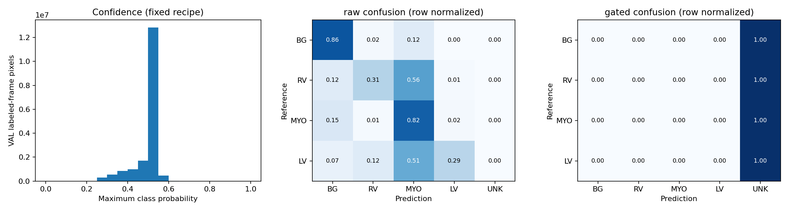

# DINOv3 full50: exposed VAL development evaluation

18 patients, 36 ED/ES reference frames. Full-cine predictions were frozen before references were opened for scoring. No threshold sweep or optimizer updates.

Checkpoint manifest SHA256: `fb9d830574845c6e0802c89b6ebe4f5647793326c6a613391595be847670ca85`.

Fixed gate: probability >= 0.7, margin >= 0.2; UNKNOWN=255. Batch 1, FP32, RTX 4070. Peak allocated 239.4 MiB; reserved 308.0 MiB (PyTorch allocator only).

| Class | Raw Dice | Gated Dice | AUROC | AP |
|---|---:|---:|---:|---:|
| RV | 0.183558 | 0.000000 | 0.847031 | 0.165548 |
| MYO | 0.149129 | 0.000000 | 0.921025 | 0.152535 |
| LV | 0.360623 | 0.000000 | 0.817770 | 0.355612 |

Metrics are macro means over reference frames. AUROC/AP use raw per-class probabilities, one versus rest. Gated Dice is evaluated over the complete reference domain: abstentions remain UNKNOWN and count as missed foreground. Selective Dice is separately available in METRICS.json; it must be read with coverage.

Mean foreground coverage: 0.0000%; mean overall coverage: 0.0000%.

All patient/frame scores, raw and gated 4x5 confusion counts, and confidence histogram bins are in [METRICS.json](METRICS.json).

Maximum native minus lifted coarse logits: 0.0. Maximum raw detail: 0.0. These predictions contain no learned native detail.

## Source audit and pilot decision

All 80 TRAIN NPZ payload hashes verified; read only R0, Q, reliability, labels; no patient reference read.

Do not infer H06 versus H07 from support counts. Need a reviewed image-only VAL teacher/source diagnostic path matching pinned producer before source qualification. No GT target generation. No native pilot launched.

Paired R0/Q/coarse/native VAL attribution remains incomplete: the inspected teacher banks contain TRAIN only. Historical VAL Q/Z exports are different student variants, not the matching teacher source. No GT was used to rebuild targets; no H06/H07 choice, EMA, recurrent audit, or gradient guard was enabled. A source-matched VAL diagnostic export is still needed before the requested conditional native-detail pilot.

## Provenance and verification

Mirror weights hash-pinned and runtime-verified; official direct download returned 403; upstream full-digest lineage not independently verified; no full Meta certification.

`python scripts/check_repo.py`: exit 1 because pre-existing retired/untracked directories remain in this live checkout; no directories were removed. `python -m pytest -q`: see pytest.log. The additional manufactured metric/geometry contract tests passed (2 tests); this is software evidence only.

Initial GPU prediction attempt stopped because the training environment lacked nibabel. No prediction was written. nibabel 5.3.2 was installed into a separate evaluation dependency directory; the retry used the same frozen checkpoint and recipe. GPU inference started only after no compute process was present on the RTX 4070.

Scoring v1 stopped before metrics because 7 patients had different cine/reference affines. Scoring v2 requires exact frame-image/cine voxel equality and GT/frame-image shape and affine equality for all 36 reference frames. No resampling or threshold change was performed. See SCORING_POLICY_v2.json and GEOMETRY_VERIFIED.json.

TRAIN source summary (teacher-grid cells, not native VAL pixels): R0 argmax counts BG/RV/MYO/LV = [45488290, 95391, 904973, 86706]; Q argmax counts = [44614861, 173642, 1692285, 94572]; gated counts = [795189, 5199, 61712, 6777]. UNKNOWN fraction = 98.134471%. Nonzero R0 mass includes priors and is not proof of anatomical support.
