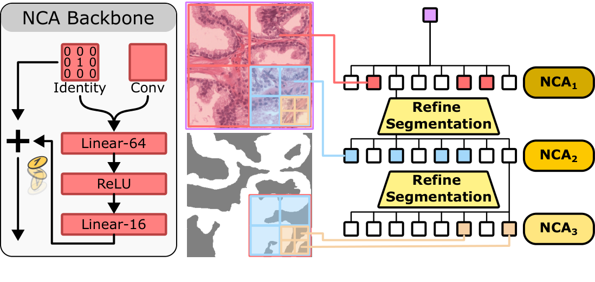

# Mở lại hướng nghiên cứu teacher–student cho cardiac MRI

2026-11-05. Đây là vòng nghiên cứu mở rộng theo yêu cầu mới, không phải bản đổi tên của thiết kế residual/fusion trước. Trạng thái các phương pháp: PROPOSED, chưa huấn luyện và chưa có kết quả bệnh nhân.

## Quyết định khoa học

Chuyển câu hỏi trung tâm từ “làm student giống feature teacher” sang **“teacher nên truyền đối tượng nào để student thực hiện quyết định phân đoạn tốt hơn dưới một ngân sách tính toán cụ thể?”** Bốn trục ban đầu vẫn giữ, nhưng teacher mạnh là hạ tầng thực nghiệm; representation, transfer và student cần cùng phục vụ một giả thuyết có thể bị bác bỏ.

Không chốt một phương pháp bằng bỏ phiếu hội đồng. Giữ ba chương trình cạnh tranh và một nhánh mở rộng đầu vào. Lựa chọn ưu tiên dưới đây là đánh giá của coordinator, không phải kết quả thực nghiệm hay chứng nhận novelty.

| Chương trình | Representation sau hai encoder | Teacher truyền gì? | Student thực sự tính gì khi deploy? | Chỗ có thể tạo đóng góp |
|---|---|---|---|---|
| A. Chương trình xây dựng vùng | Trạng thái vùng, biên, quan hệ kề và các hành động khả thi | Giá trị/quy tắc chọn split, merge, relabel, stop trên trạng thái student | Chính sách tạo phân hoạch thích nghi rồi rasterize | Học cách phân bổ độ phân giải và thứ tự xử lý từ teacher; hiệu quả theo ngân sách |
| B. Phân bố trên các phân hoạch | Luật xác suất chung trên nhiều cách chia vùng và gán nghĩa | Quan hệ phụ thuộc và đáp ứng truy vấn của các phương án cấu trúc | Mạch xác suất thực hiện sum-product để tạo xác suất lớp từng pixel | Giữ bất định cấu trúc và dùng nó trực tiếp trong decoding |
| C. Bộ giải cấu trúc | Toán tử trên graph + nguồn bằng chứng từ student | Đáp ứng của bộ giải trước các can thiệp, thay vì chỉ nghiệm cuối | Dự đoán hệ số từ ảnh rồi chạy số vòng giải cố định | Chuyển hành vi tính toán có kiểm tra được và kiểm soát sai số nén |
| D. Trường vật liệu theo thời gian | Giải phẫu trong hệ tọa độ mô và ánh xạ chuyển động/visibility | Correspondence và động lực học có bất định | Renderer theo tọa độ với trạng thái thời gian | Nhánh rủi ro cao, dành cho protocol cine riêng |

## A — Hướng ưu tiên: teacher dạy một chương trình phân đoạn

Student không xuất ngay feature để đưa qua một decoder U-Net. Nó tạo một trạng thái vùng, rồi thực thi một chương trình hữu hạn: chia vùng ở đâu, gộp vùng nào, đổi nhãn nào, dừng lúc nào. Cùng ảnh x đi qua E_T và E_S; representation huấn luyện của một vùng là:

`z_r = [pool_r E_T(x), pool_r E_S(x), geometry(r), adjacency(r)]`.

Teacher-assisted planner đánh giá những hành động student thực sự làm được. Với trạng thái s và hành động a, dùng một lookahead cố định H:

`A_T(s,a) = E_T(s) − E_T(Complete_H(s,a))`.

Student học chính sách chọn hành động có ích, đồng thời nhận segmentation supervision trên đường thực thi của chính mình. Những chuỗi hành động khác nhau cho cùng mask phải được xem là tương đương, tránh ép một thứ tự tùy ý. Trên U, giá trị do teacher cung cấp chỉ là pseudo-objective; TRAIN-L mới cho phép kiểm tra hành động đó thực sự cải thiện nhãn.

Đường deploy: **ảnh → stem nhỏ → graph vùng → K quyết định → rasterizer native**. Teacher không nằm trong artifact deploy. Các vùng cần chi tiết có thể được chia tới độ phân giải ảnh; chi phí truy vấn chi tiết, lựa chọn hành động và rasterization đều phải tính. Một biến thể giữ hệ số trên lưới tam giác thích nghi, dùng nội suy barycentric thay decoder convolution; không ép một template tim cố định.

Đóng góp tiềm năng nằm ở *quyết định tính toán được teacher hướng dẫn*, không nằm ở việc dùng graph hay quadtree. [OctreeNCA](https://www.alphaxiv.org/pdf/2508.06993?page=5) đã có phân đoạn bằng cập nhật cục bộ và truyền trạng thái qua nhiều độ phân giải. [D-RASP](https://www.alphaxiv.org/pdf/2602.08857?page=4) đã nghiên cứu lấy chương trình từ Transformer trong các bài toán thuật toán hạn chế. Ta chưa có chứng minh rằng teacher cardiac bất kỳ nén được thành chương trình nhỏ.

**Thử nghiệm phân định:** cùng primitives, số bước, teacher và dữ liệu, so chính sách dùng teacher structural evidence với planner chỉ thấy đúng teacher logits; thêm planner image-only có cùng compute và chương trình bị hoán đổi giữa ảnh. Nếu lợi ích chỉ đến từ thêm thời gian tìm kiếm hoặc từ logits, luận điểm chuyển thuật toán thất bại.

**Rủi ro lớn:** vùng thô đã gộp mất một dải MYO mỏng thì chính sách tốt không khôi phục được nếu không có hành động tách thích hợp. Cần kiểm tra khả năng biểu diễn trước khi train policy. Fit heuristic không đạt không chứng minh mọi cách fit đều thất bại; phải phân biệt nghiệm đạt được với upper bound được chứng minh.

## B — Đối thủ khoa học rủi ro cao: giữ nhiều cấu trúc có thể đúng

Ở vùng low contrast, có thể tồn tại nhiều phân hoạch hợp lý. Thay vì nén chúng thành một vector hoặc một ma trận affinity, học luật chung `q(pi,a|x)` trên phân hoạch pi và nhãn vùng a. Teacher và student cùng ảnh tạo luật huấn luyện; student tự dự đoán các factor khi deploy:

`p_S(y_i=c|x) = sum_(pi,a) q_S(pi,a|x) 1[a_region(i,pi)=c]`.

Decoder phải thực hiện phép marginalization này. Nếu phía sau có một dense head đủ mạnh bỏ qua luật phân hoạch, không còn bằng chứng cho cơ chế. Một mixture hữu hạn các cây không gian cho phép sum-product tractable; số cây, độ sâu, native leaves và thời gian xây cây đều là ngân sách thật.

Điểm phân biệt quan trọng: có hai luật trên ba điểm có mọi xác suất cùng-vùng theo cặp bằng 1/2, nhưng xác suất cả ba cùng-vùng lần lượt là 1/2 và 1/4. Matching pairwise không xác định được luật chung. Tuy nhiên điều này không phủ định mọi relational KD: [RKD](https://www.alphaxiv.org/pdf/1904.05068?page=3) có công thức quan hệ tổng quát bậc cao. Câu hỏi mới phải là **dùng một luật chung hợp lệ để suy luận có giúp segmentation hơn chỉ matching các truy vấn tương tự hay không?**

[Codebook-Guided KD](https://www.alphaxiv.org/pdf/2609.37243?page=4) cũng đã có code rời rạc, chọn theo task relevance và student compatibility. Vì vậy “anatomical codebook” không đủ làm claim. Cần so cùng dung lượng với VQ/codebook transfer và decoder thông thường, không chỉ với feature MSE yếu.

**Thử nghiệm phân định:** kiểm tra truy vấn joint, rồi so full circuit với pairwise-only và deterministic decoder có cùng chi phí. Đánh giá cả MYO boundary và calibration. Nếu phải tăng số cây gần mức liệt kê pixel, hoặc trung bình hóa tạo biên mờ, mất lý do dùng mô hình compact. Đây là đối thủ có upside khoa học nhưng rủi ro expressiveness cao hơn A.

## C — Nhánh khả thi hơn: truyền một bộ giải, không chỉ truyền mask

Teacher encoder tạo liên kết giải phẫu; student encoder tạo nguồn bằng chứng. Representation fused là nghiệm của hệ, ví dụ `H_TS=(I+tau L_T)^(-1)b_S`. Student deploy tự dự đoán `L_S,b_S`, rồi chạy cùng bộ giải với số bước cố định. Một biến thể dùng stochastic transition P và response `(1-alpha)(I-alpha P)^(-1)`.

Tri thức được hỏi bằng nhiều nguồn kích thích hoặc trạng thái ban đầu có kiểm soát. Nếu chỉ dùng bốn nguồn tương ứng bốn class logits, “operator transfer” có thể chỉ là output KD được viết lại. Can thiệp phải tạo được phép thử độc lập về cách thông tin lan truyền, và final Dice của teacher không chứng nhận graph head đúng.

Không mặc định nén graph giữ được đáp ứng. Phép thử ba trạng thái trong `probe_structured_claims.py` cho thấy **chiếu graph rồi giải khác chiếu nghiệm của graph gốc**, ngay cả với transition hợp lệ. Cần điều kiện lumpability hoặc đo trực tiếp response error theo mức nén. Đây là kết quả đại số trên fixture, không phải thất bại hay thành công trên MRI.

**Thử nghiệm phân định:** teacher graph thật so với graph hoán vị/rewiring có kiểm soát, cùng student solver không transfer, KD thường, và can thiệp đa dạng so với chỉ semantic probes. Luôn chấm student-only. Bộ giải ổn định vẫn có thể lan truyền sai nhãn và xóa MYO; convergence không tương đương anatomy correctness.

Nhánh C là comparator cơ chế đáng xây trước nếu A/B quá khó, nhưng prior art về structured prediction, graph solvers và operator learning cần được truy sâu thêm trước khi viết claim. Không gọi nó là mới chỉ vì packet hiện tại chưa tìm thấy một paper giống hoàn toàn.

## D — Mở rộng thực sự sang động học, nhưng phải đổi protocol rõ ràng

Một cùng ảnh tức thời có thể xuất hiện khi cơ tim đang co hoặc giãn; một frame không xác định được vận tốc bệnh nhân. Teacher được xem cine có thêm thông tin lúc train nhưng không thể làm thông tin đó xuất hiện chắc chắn trong một frame lúc test. Nếu giữ single-image deployment, chỉ có thể học phân bố các dynamics phù hợp và kiểm tra xem chúng có giúp mask không.

Nhánh mạnh hơn về bài toán là cho cả teacher/student cùng cine: biểu diễn trường mô `a(u)`, ánh xạ `phi_t` và visibility, rồi tạo mask từ `a(phi_t^-1(r))`. Nó khác temporal consistency giữa các mask độc lập. Nhưng [NISF++](https://www.alphaxiv.org/pdf/2608.00752?page=5) đã có neural fields không gian–thời gian và fitting từng subject; [CineMesh4D](https://www.alphaxiv.org/pdf/2605.13994?page=3) đã có multi-view image-to-mesh và contour rendering. Chỉ đổi sang mesh/4D chưa đủ mới. Cần kiểm tra correspondence, missing views, visibility và chi phí amortized inference. Không dùng kết quả của protocol cine để chứng minh lợi ích same-image.

## Teacher: chọn theo cả segmentation lẫn loại tri thức cần dạy

Chưa xác nhận được teacher tái lập 96% **foreground mean Dice trên cả ACDC và M&Ms** trong vòng này. Không dùng một số headline để chọn kiến trúc. Khóa patient-level foreground RV/MYO/LV, Macro4 riêng, phase, spacing, empty-class handling và evaluation split trước.

Nhóm baseline đáng tái lập: [nnU-Net/ResEnc](https://github.com/MIC-DKFZ/nnUNet/blob/master/documentation/resenc_presets.md), [MedNeXt](https://github.com/MIC-DKFZ/MedNeXt), encoder pretrained CMR với head đủ năng lực, và ensemble có khai báo compute. Coordinator đã mở tài liệu/repository chính thức hiện tại; chưa audit checkpoint hay tái lập recipe. Đây là ứng viên thực nghiệm, không phải danh sách đã xác lập SOTA.

Primary XML được kiểm tra lại: [ABR-UNet3D Table3](https://doi.org/10.3390/diagnostics16111598) báo96.03 khi gồm BG; trung bình RV/MYO/LV từ bảng là94.74%, không có M&Ms. [CASNet](https://doi.org/10.3389/fmed.2025.1688872) báo96.3ACDC/95.7M&Ms-2, còn mơ hồ aggregation/split. Vì vậy cả hai chưa xác lập mục tiêu96foreground trên đúng hai dataset. Chi tiết ở `teacher/final.md`.

Tách hai nghiên cứu: teacher cùng K TRAIN patients để đo annotation efficiency toàn hệ thống; teacher toàn TRAIN để đo compression/transfer có đặc quyền nhãn. Trong track sau, student chỉ dùng trực tiếp K nhãn không làm toàn hệ thống trở thành K-label. External pretraining, multi-view/context và structural-head supervision phải khai báo.

Một teacher tốt cho chương trình A còn phải xếp hạng hành động sửa vùng đúng trên TRAIN-L; tốt cho B phải cung cấp thông tin cấu trúc/uncertainty có ích; tốt cho C phải tạo đáp ứng và liên kết có ích. Teacher global Dice cao không đủ để suy ra các năng lực này. Chọn teacher bằng Dice và competency probe đã khóa; không coi confidence hoặc ensemble agreement là ground truth.

## Những nhánh khác được giữ để tránh thu hẹp quá sớm

Teacher còn có thể **dạy những thay đổi acquisition nào student cần chịu được**, thay vì dạy mask: joint encoder representation chọn nuisance environments; student học robust risk trên các biến đổi có phạm vi xác định. Phải so với teacher-free augmentation có cùng severity và compute; nếu lợi ích biến mất thì không có teacher-specific transfer. Đây là hướng sát bài toán multi-vendor M&Ms nhưng prior art về robust optimization/domain randomization chưa được khảo sát đủ trong vòng này. Nó chỉ đáp ứng gián tiếp yêu cầu dual-encoder representation, không nên ép vào cùng paper với A.

Một nhánh khác là **posterior trên các giải thích giải phẫu**, có annotation observation model và student decoder chung. Không có repeated annotations thì không thể tách chắc chắn bất định annotation khỏi bất định anatomy; trước mắt cố định convention và thử nhiều latent anatomy so với một latent ở cùng coverage/cost. Ngoài ra, compilation investigator giữ hướng **học một quy tắc tối ưu có thể chuyển sang các student mới**, với query labels hoàn toàn trong TRAIN và tổng chi phí meta-training được tính. Cả hai là chương trình độc lập còn thiếu prior-art review riêng; không ghép mọi ý tưởng vào một hệ thống.

## Bằng chứng và bước quyết định tiếp theo

Sáu phiên Astra độc lập, model yêu cầu/effective `gpt-6-astra`, effort high, đã được mở qua Orca run `run_73fe63d65c01`. Mỗi phiên giữ initial.md trước khi đọc packet, rồi đọc primary methods và phản biện chéo. Coordinator làm retrieval tập trung qua orx bản trong OpenResearch.app, tám query với cutoff2026-11-05/default priority: 53 candidate IDs sau dedup; PubMed query lỗi500 được giữ trong ledger; sáu primary texts được chọn đọc phần phương pháp/input/deployment. Đây là scoping review hữu hạn, không phải systematic review toàn bộ lĩnh vực.

Thứ tự nghiên cứu được đề xuất: (1) cố định evaluator và teacher reference; (2) kiểm tra representation ceiling/identifiability của A,B,C trên bài toán nhỏ; (3) pilot được khóa trên TRAIN nội bộ để phân biệt cơ chế và compute; (4) chỉ sau khi có tín hiệu mới đầu tư teacher mạnh, scale model và đánh giá xác nhận. Không cần đợi một headline96 mới được bác bỏ một representation sai.

Đã chạy ba nhóm counterexample nhỏ, chỉ `FIXTURE_ONLY`: pairwise không xác định partition law; coarsening có thể làm mất biên không phục hồi; projection và graph solve không giao hoán. Sau phản biện, coordinator kiểm tra thêm trong cùng nhóm partition: với cùng soft image evidence, bốn semantic labels và hai luật khả thi, posterior pixel là61/100 so với139/250. Điều này chứng minh khác biệt có thể đi tới output của decoder; chưa chứng minh student học được luật hữu ích hay tăng Dice. Repo source không đổi; `check_repo.py` PASS; pytest43passed,1warning. Không dùng model weights, không huấn luyện bệnh nhân/GPU, không đổi experiment/job trên OpenResearch. Chi tiết hash và lifecycle ở `VALIDATION.json`, `COUNCIL_PROVENANCE.json` và `MANIFEST.json`.

Hình gốc [OctreeNCA Figure2,p.4](https://www.alphaxiv.org/pdf/2508.06993?page=4), crop giữ nguyên nội dung và nhãn; dùng để đối chiếu prior art, không phải kiến trúc đề xuất. Nguồn và bbox nằm trong `figures/provenance.json`.

## Kết luận sau phản biện

16 ý tưởng ban đầu của sáu chuyên gia đã được giữ nguyên trước packet. Phản biện dẫn tới các thay đổi cụ thể: partition decoder phải biểu diễn được counterexample trong chính family của nó; action equivalence phải tính cả state/resource còn lại; solver hữu hạn phải được mô tả bằng phép lặp thực tế; teacher cùng endpoint có thể khác hoàn toàn về action/response competence; annotation uncertainty bị thu hẹp do thiếu dữ liệu nhận diện.

Coordinator ưu tiên A vì nó nối representation, transfer và kiến trúc thành một câu hỏi có phép can thiệp rõ. B là đối thủ khoa học cần giữ vì nó thay cả đối tượng suy luận; C là comparator khả thi hơn để kiểm tra giá trị của structured computation. D và các nhánh robust/variational/meta-learning là chương trình khác, không dùng làm phụ kiện để tăng số novelty claims. Trước khi gọi một hướng là contribution mới, cần khảo sát chuyên sâu adaptive partition/mesh, structured probabilistic prediction, learned solvers hoặc program learning đúng với hướng được chọn; vòng rộng hiện tại chưa đủ giải quyết các khoảng trống đó.

Mỗi task có `initial.md`, `final.md`, `peer_review.md`; mọi outcome nghiên cứu được ghi riêng trong provenance. Geometry đã nhận và xử lý phản biện, nhưng phản hồi cuối gửi trực tiếp tới hai peer bị từ chối vì các dispatch đó đã hoàn tất; phản hồi được coordinator nhận và lưu. Không trình bày bước này như một vòng peer xác nhận bổ sung đã diễn ra.
